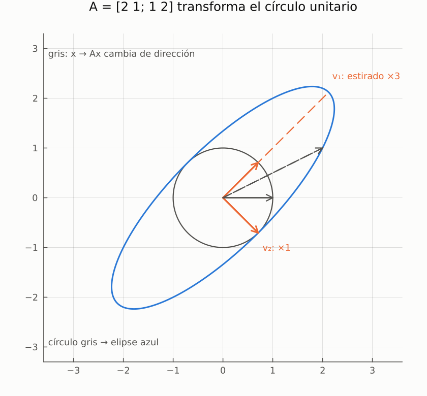
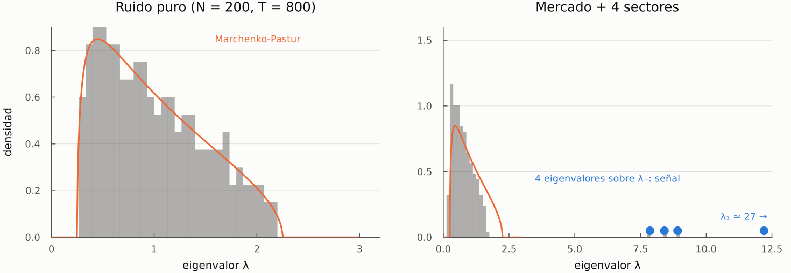

# Repaso: álgebra lineal

> Cada concepto tiene una clave (por ejemplo **[L.I2](#li2)**) y dice en qué semanas
> se usa. El índice [README.md](README.md) indica qué repasar antes de cada
> sesión. Los fragmentos de Julia corren en el entorno del curso
> (`julia --project=Code`).
>
> - **Básico**: lo necesario para la ruta básica.
> - **Intermedio**: lo necesario para leer las notas formales.
> - **Avanzado**: lo necesario para la ruta avanzada.

---

## Nivel básico

<a id="lb1"></a>

### L.B1 Vectores, producto punto y norma
*Semanas 5, 8.*

Un **vector** $x \in \mathbb{R}^n$ es una lista de $n$ números. En el curso,
un vector puede ser la serie de retornos de un activo ($n$ = días), la
riqueza de $n$ agentes o el estado de $n$ nodos.

$$
x \cdot y = \sum_{i=1}^n x_i y_i,
\qquad
\Vert x\Vert = \sqrt{x \cdot x},
\qquad
\cos\theta = \frac{x \cdot y}{\Vert x\Vert\thinspace\Vert y\Vert}.
$$

- $x \cdot y = 0$: los vectores son **ortogonales** (perpendiculares).
- $\Vert x - y\Vert$ es la distancia euclidiana entre $x$ e $y$.

**La correlación es un coseno.** Si $\tilde x$ y $\tilde y$ son las series
centradas (se les resta su media), la correlación de Pearson es

$$
\rho_{xy} = \frac{\tilde x \cdot \tilde y}{\Vert\tilde x\Vert\thinspace\Vert\tilde y\Vert} = \cos\theta.
$$

Correlación 1: apuntan en la misma dirección; 0: ortogonales; −1: opuestos.

<a id="lb2"></a>

### L.B2 Matrices y sus operaciones
*Semanas 3, 5, 8, 9.*

Una **matriz** $A \in \mathbb{R}^{m \times n}$ tiene $m$ filas y $n$
columnas; $A_{ij}$ es el elemento de la fila $i$, columna $j$.

- **Matriz por vector**: si $y = Ax$, entonces $y_i = \sum_j A_{ij}x_j$. Cada
  componente es el producto punto de una fila de $A$ con $x$.
- **Matriz por matriz**: si $M = AB$, entonces $M_{ij} = \sum_k A_{ik}B_{kj}$. Requiere que las
  columnas de $A$ coincidan con las filas de $B$. En general $AB \ne BA$.
- **Transpuesta**: $A^\top$ intercambia filas y columnas, $A^\top_{ij} = A_{ji}$. $A$ es **simétrica** si
  $A = A^\top$.
- **Identidad** $I$: unos en la diagonal, ceros fuera. $AI = IA = A$.
- **Inversa**: $A^{-1}$ cumple $AA^{-1} = I$. Existe sólo si $A$ es cuadrada
  y $\det A \ne 0$. El sistema $Ax = b$ tiene solución única
  $x = A^{-1}b$.
- **Traza**: $\mathrm{tr}(A) = \sum_i A_{ii}$.

En Julia, `A * x` es el producto matricial, `A .* B` el producto elemento a
elemento, `A'` la transpuesta y `A \ b` resuelve $Ax = b$ (mejor que
calcular la inversa).

<a id="lb3"></a>

### L.B3 Matrices como datos
*Semanas 1, 5.*

Una tabla de retornos de $N$ activos durante $T$ días es una matriz
$R \in \mathbb{R}^{T \times N}$: cada **columna** es un activo, cada
**fila** un día. Si se estandariza cada columna (media 0, varianza 1) y se
llama $Z$ al resultado, la **matriz de correlación** es

$$
C = \frac{1}{T-1}\thinspace Z^\top Z \in \mathbb{R}^{N \times N},
\qquad C_{ij} = \rho_{ij}.
$$

```julia
using Statistics, Random
R = randn(Xoshiro(1), 1_000, 5)       # 1000 días, 5 activos (ruido puro)
C = cor(R)                            # matriz de correlación 5×5
Z = (R .- mean(R; dims = 1)) ./ std(R; dims = 1)
C ≈ Z' * Z / (size(R, 1) - 1)         # true
```

<a id="lb4"></a>

### L.B4 Matriz de adyacencia
*Semanas 8, 9, 11, 12.*

Una red con $n$ nodos se representa con la **matriz de adyacencia**
$A \in \lbrace0,1\rbrace^{n \times n}$: $A_{ij} = 1$ si hay un enlace de $i$ a $j$.

- **No dirigida**: $A$ es simétrica. **Dirigida**: no necesariamente
  (por ejemplo, préstamos de un banco a otro).
- **Pesada**: $A_{ij} = w_{ij}$, la intensidad del enlace (monto del
  préstamo, volumen de comercio).
- **Grado** del nodo $i$: $k_i = \sum_j A_{ij}$, la suma de su fila. En
  forma matricial, $k = A\mathbf{1}$, con $\mathbf{1}$ el vector de unos.
- Número de enlaces (no dirigida): $m = \tfrac12\sum_i k_i$.

```julia
A = [0 1 1 0;
     1 0 1 0;
     1 1 0 1;
     0 0 1 0]
k = A * ones(Int, 4)        # grados: [2, 2, 3, 1]
```

---

## Nivel intermedio

<a id="li1"></a>

### L.I1 Eigenvalores y eigenvectores
*Semanas 3, 5, 8, 12.*

Un vector $v \ne 0$ es un **eigenvector** (vector propio) de la matriz
cuadrada $A$, con **eigenvalor** $\lambda$, si

$$
Av = \lambda v.
$$

$A$ no cambia la dirección de $v$, sólo lo estira por un factor $\lambda$.

- Los eigenvalores son las raíces del **polinomio característico**
  $\det(A - \lambda I) = 0$.
- Para una matriz $2 \times 2$:
  $\lambda^2 - \mathrm{tr}(A)\thinspace\lambda + \det A = 0$.
- Siempre: $\sum_i \lambda_i = \mathrm{tr}(A)$ y
  $\prod_i \lambda_i = \det A$.



*A transforma el círculo unitario en una elipse. Los eigenvectores (naranja) sólo se estiran, v₁ por 3 y v₂ por 1, y marcan los ejes de la elipse. Cualquier otro vector, como x, además cambia de dirección.*

**Por qué importan.** Si $A$ actúa repetidamente (una dinámica
$x_{t+1} = Ax_t$), escribir $x_0$ en la base de eigenvectores desacopla el
problema: cada componente se multiplica por su $\lambda_i$ en cada paso.
Las componentes con $|\lambda_i| > 1$ crecen y las de $|\lambda_i| < 1$
mueren. Esta idea aparece en las cadenas de Markov ([E.I3](procesos_estocasticos.md#ei3)), en la
centralidad ([L.I4](#li4)) y en la estabilidad ([L.A3](#la3)).

<a id="li2"></a>

### L.I2 Matrices simétricas y teorema espectral
*Semanas 5, 8.*

**Teorema espectral.** Si $A$ es real y simétrica, entonces

1. todos sus eigenvalores son **reales**;
2. tiene $n$ eigenvectores **ortonormales** $v_1, \dots, v_n$;
3. se descompone como $A = \sum_i \lambda_i\thinspace v_i v_i^\top$.

Las matrices de covarianza, de correlación y de adyacencia de redes no
dirigidas son simétricas.

**Semidefinida positiva.** $A$ es semidefinida positiva si
$x^\top A x \ge 0$ para todo $x$; equivale a $\lambda_i \ge 0$. Toda matriz
de covarianza lo es, porque $x^\top C x$ es la varianza del portafolio con
pesos $x$, y una varianza no puede ser negativa.

**Para la matriz de correlación** de $N$ activos:
$\lambda_i \ge 0$ y $\sum_i \lambda_i = \mathrm{tr}(C) = N$ (unos en la
diagonal). Por eso $\lambda_i / N$ se interpreta como la **fracción de la
varianza total** en la dirección $v_i$.

<a id="li3"></a>

### L.I3 Componentes principales y modo de mercado
*Semana 5.*

El eigenvector $v_1$ con el mayor eigenvalor de $C$ es la combinación de
activos con **mayor varianza**: la "dirección principal" de los datos.

**Modelo de un factor.** Supón que todos los pares de activos tienen la
misma correlación $\rho > 0$. Entonces $C = (1-\rho)I + \rho\thinspace\mathbf{1}\mathbf{1}^\top$ y

- $v_1 = \mathbf{1}/\sqrt{N}$ (todos los activos con el mismo peso) con
  $\lambda_1 = 1 + (N-1)\rho$;
- los demás $N - 1$ eigenvalores valen $1 - \rho$.

*Demostración.* $C\mathbf{1} = (1-\rho)\mathbf{1} + \rho N\mathbf{1}$. Para
cualquier $v \perp \mathbf{1}$, $\mathbf{1}^\top v = 0$ y $Cv = (1-\rho)v$. $\square$

En datos reales, $v_1$ tiene todas sus componentes del mismo signo y
$\lambda_1$ es mucho mayor que el resto: es el **modo de mercado**, el
movimiento común de todas las acciones. Los siguientes eigenvectores suelen
agrupar acciones del mismo **sector**.

```julia
using LinearAlgebra
N, ρ = 50, 0.3
C = (1 - ρ) * I(N) + ρ * ones(N, N)
λ = eigvals(Symmetric(C))
λ[end], 1 + (N - 1) * ρ            # 15.7 y 15.7
```

<a id="li4"></a>

### L.I4 Potencias de matrices: caminos y centralidad
*Semanas 3, 8, 9.*

**Caminos.** $(A^k)_{ij}$ es el número de caminos de longitud $k$ del nodo
$i$ al $j$. Consecuencias:

- $(A^2)_{ii} = k_i$ (ir a un vecino y regresar).
- $\mathrm{tr}(A^3)/6$ es el número de **triángulos** en una red no
  dirigida; de ahí sale el coeficiente de agrupamiento.

**Método de la potencia.** Para casi cualquier $x_0$, la sucesión
$x_{t+1} = Ax_t/\Vert Ax_t\Vert$ converge al eigenvector del eigenvalor de mayor
valor absoluto. Es lo que pasa al iterar una cadena de Markov hasta su
distribución estacionaria ([E.I3](procesos_estocasticos.md#ei3)).

**Centralidad de eigenvector.** Un nodo es importante si está conectado con
nodos importantes: $x_i \propto \sum_j A_{ij}x_j$, es decir, $Ax = \lambda x$.
Se toma el eigenvector del mayor eigenvalor; **Perron-Frobenius** ([L.A5](#la5))
garantiza que tiene todas sus componentes positivas. PageRank es una
variante de esta idea.

```julia
using LinearAlgebra
A = [0 1 1 0; 1 0 1 0; 1 1 0 1; 0 0 1 0]
tr(A^3) ÷ 6                                   # 1 triángulo
v = eigvecs(Symmetric(float(A)))[:, end]      # eigenvector del mayor λ
abs.(v) ./ sum(abs.(v))                       # centralidad: el nodo 3 es el más central
```

<a id="li5"></a>

### L.I5 Distancia entre activos
*Semanas 5, 8.*

Para construir una red a partir de correlaciones hace falta una
**distancia**. Si $\hat z_i$ es la serie estandarizada del activo $i$
dividida entre su norma ($\Vert\hat z_i\Vert = 1$), entonces
$\hat z_i \cdot \hat z_j = \rho_{ij}$ y

$$
\Vert\hat z_i - \hat z_j\Vert^2 = 2 - 2\rho_{ij}
\quad\Longrightarrow\quad
d_{ij} = \sqrt{2(1 - \rho_{ij})}.
$$

Como es una distancia euclidiana entre vectores, cumple la desigualdad del
triángulo. Va de 0 ($\rho = 1$) a 2 ($\rho = -1$). Con ella se construye el
**árbol de expansión mínima** de Mantegna (1999): conectar los $N$ activos
con $N-1$ enlaces de distancia total mínima.

---

## Nivel avanzado

<a id="la1"></a>

### L.A1 El Laplaciano de una red
*Semana 8.*

$$
L = D - A,
\qquad D = \mathrm{diag}(k_1, \dots, k_n).
$$

- $L\mathbf{1} = 0$: el 0 siempre es eigenvalor.
- $x^\top L x = \sum_{\text{enlaces } (i,j)} (x_i - x_j)^2 \ge 0$: $L$ es
  semidefinida positiva.
- La **multiplicidad del eigenvalor 0** es el número de componentes
  conexas de la red.
- El segundo eigenvalor más pequeño, $\lambda_2$ (**conectividad
  algebraica**), mide qué tan difícil es partir la red en dos. Su
  eigenvector (vector de Fiedler) sugiere la partición.
- **Difusión en la red**: $\dot x = -Lx$ hace que cada nodo se acerque al
  promedio de sus vecinos. La velocidad de convergencia al consenso la fija
  $\lambda_2$ (relacionado con el modelo de votante, semana 11).

<a id="la2"></a>

### L.A2 Matrices aleatorias y Marchenko-Pastur
*Semana 5.*

Si los $N$ activos fueran **independientes** y tuviéramos $T$ días, la
matriz de correlación muestral no sería la identidad: el ruido de
estimación dispersa sus eigenvalores. Para $N, T \to \infty$ con
$Q = T/N \ge 1$ fijo, la densidad de eigenvalores converge a la ley de
**Marchenko-Pastur**:

$$
\rho(\lambda) = \frac{Q}{2\pi}\thinspace\frac{\sqrt{(\lambda_+ - \lambda)(\lambda - \lambda_-)}}{\lambda},
\qquad
\lambda_\pm = \left(1 \pm \frac{1}{\sqrt{Q}}\right)^2,
$$

para $\lambda \in [\lambda_-, \lambda_+]$, y cero fuera.

**Uso.** Los eigenvalores empíricos dentro de $[\lambda_-, \lambda_+]$ son
indistinguibles del ruido. Los que quedan por encima de $\lambda_+$ (el modo
de mercado y algunos sectores) son **señal** (Laloux et al., 1999). Barajar
cada serie por separado, como en el laboratorio, produce numéricamente este
mismo espectro de ruido.



*Izquierda: con activos independientes, los eigenvalores llenan el intervalo de Marchenko-Pastur. Derecha: con un factor de mercado y 4 sectores salen 4 eigenvalores del ruido (el modo de mercado, λ₁ ≈ 27, y 3 contrastes entre sectores); el resto queda a la izquierda de la curva porque esos factores absorben parte de la varianza.*

```julia
using LinearAlgebra, Statistics, Random
N, T = 100, 400
λ = eigvals(Symmetric(cor(randn(Xoshiro(1), T, N))))
Q = T / N
extrema(λ), ((1 - 1/sqrt(Q))^2, (1 + 1/sqrt(Q))^2)   # ≈ (0.25, 2.25)
```

<a id="la3"></a>

### L.A3 Jacobiano y estabilidad lineal
*Semanas 12, 14.*

**Tiempo continuo.** Para $\dot x = f(x)$ con $x \in \mathbb{R}^n$, un
**punto fijo** $x^\ast$ cumple $f(x^\ast) = 0$. Cerca de él,
$\dot{\delta} \approx J\thinspace\delta$ con $\delta = x - x^\ast$ y el **jacobiano**

$$
J_{ij} = \left.\frac{\partial f_i}{\partial x_j}\right|_{x^\ast }.
$$

$x^\ast$ es **estable** si todos los eigenvalores de $J$ tienen parte real
negativa, e inestable si alguno la tiene positiva.

En dos dimensiones basta con la traza $\tau$ y el determinante $\Delta$ de
$J$: estable si $\tau < 0$ y $\Delta > 0$; **punto silla** si $\Delta < 0$;
eigenvalores complejos (espirales u órbitas) si $\tau^2 < 4\Delta$. En
Lotka-Volterra (y el ciclo de Goodwin) el punto interior tiene $\tau = 0$ y
$\Delta > 0$: eigenvalores imaginarios puros y órbitas cerradas.

**Tiempo discreto.** Para $x_{t+1} = F(x_t)$, el punto fijo es estable si
todos los eigenvalores del jacobiano de $F$ cumplen $|\lambda| < 1$. Al
variar un parámetro, el punto fijo pierde estabilidad cuando un eigenvalor
sale del círculo unitario: por $+1$ (bifurcación de horquilla), por $-1$
(duplicación de periodo: aparece un ciclo de periodo 2) o un par complejo
(bifurcación de Hopf: aparecen oscilaciones). El modelo de Brock-Hommes
(semana 14) pasa por varias de ellas al aumentar la intensidad de elección.

<a id="la4"></a>

### L.A4 Series de matrices y puntos fijos
*Semanas 8, 9.*

**Radio espectral**: $r(A) = \max_i |\lambda_i|$. Si $r(A) < 1$,

$$
(I - A)^{-1} = I + A + A^2 + \cdots = \sum_{k=0}^\infty A^k.
$$

Interpretación: un choque inicial $s$ se propaga como $s + As + A^2 s + \cdots$;
el efecto total es $(I - A)^{-1}s$. Esta estructura aparece en:

- **Centralidad de Katz**: $x = \sum_k \alpha^k A^k\mathbf{1}$, que requiere
  $\alpha < 1/r(A)$.
- **Contagio financiero**: en DebtRank, las pérdidas se propagan por la
  matriz de exposiciones. Si $r < 1$, el choque se amortigua; si $r > 1$,
  se amplifica.
- **Eisenberg-Noe**: el vector de pagos $p$ de los bancos es un punto fijo
  $p = \Phi(p)$, donde cada banco paga lo mínimo entre lo que debe y lo que
  tiene (sus activos más lo que le pagan los demás). Se resuelve iterando
  $p_{t+1} = \Phi(p_t)$ desde $p_0$ = deuda total.

<a id="la5"></a>

### L.A5 Teorema de Perron-Frobenius
*Semanas 3, 8, 9.*

Si $A$ tiene entradas no negativas y es **irreducible** (en la red asociada
se puede llegar de cualquier nodo a cualquier otro), entonces:

1. su eigenvalor de mayor valor absoluto es real y positivo,
   $\lambda_1 = r(A)$;
2. es simple (multiplicidad 1);
3. su eigenvector tiene todas sus componentes estrictamente positivas.

Aplicaciones: la distribución estacionaria de una cadena de Markov
irreducible existe y es única (para una matriz estocástica $\lambda_1 = 1$);
la centralidad de eigenvector está bien definida en una red conexa.

---

## Autodiagnóstico

<details>
<summary><b>1 (B).</b> Dos series centradas tienen producto punto 0. ¿Cuál es su correlación?</summary>

0: son ortogonales, el coseno del ángulo entre ellas es 0.
</details>

<details>
<summary><b>2 (B).</b> En la red con matriz <i>A</i> del ejemplo de [L.B4](#lb4), ¿cuántos enlaces hay?</summary>

La suma de grados es $2 + 2 + 3 + 1 = 8$, así que hay $8/2 = 4$ enlaces.
</details>

<details>
<summary><b>3 (B).</b> Tienes 250 días de retornos de 40 acciones en una matriz. ¿Qué dimensiones tiene la matriz de correlación?</summary>

$40 \times 40$: una fila y una columna por activo.
</details>

<details>
<summary><b>4 (B).</b> Calcula <i>Ax</i> con <i>A</i> = [[1, 2], [0, 3]] y <i>x</i> = (1, 1).</summary>

Cada componente es el producto punto de una fila de $A$ con $x$:
$1 \cdot 1 + 2 \cdot 1 = 3$ y $0 \cdot 1 + 3 \cdot 1 = 3$. Entonces
$Ax = (3, 3)$.
</details>

<details>
<summary><b>5 (B).</b> Tres bancos: A le presta a B y B le presta a C. Escribe la matriz de adyacencia dirigida (fila = quien presta). ¿Es simétrica?</summary>

| presta \ recibe | A | B | C |
|---|---|---|---|
| **A** | 0 | 1 | 0 |
| **B** | 0 | 0 | 1 |
| **C** | 0 | 0 | 0 |

No es simétrica: que A le preste a B no implica que B le preste a A. Las
redes dirigidas en general no lo son.
</details>

<details>
<summary><b>6 (I).</b> Encuentra los eigenvalores de la matriz [[2, 1], [1, 2]] y sus eigenvectores.</summary>

$\mathrm{tr} = 4$, $\det = 3$: $\lambda^2 - 4\lambda + 3 = 0$, así que
$\lambda = 3$ y $\lambda = 1$. Eigenvectores: $(1, 1)/\sqrt2$ y
$(1, -1)/\sqrt2$. Es el modelo de un factor de [L.I3](#li3) con $N = 2$ y
$\rho = 1/2$ escalado por 2.
</details>

<details>
<summary><b>7 (I).</b> En una matriz de correlación de 100 acciones, el mayor eigenvalor vale 30. ¿Qué fracción de la varianza total explica el modo de mercado? Con el modelo de un factor, ¿qué correlación promedio sugiere?</summary>

$30/100 = 0.3$: el 30%. De $1 + 99\rho = 30$ sale $\rho \approx 0.29$.
</details>

<details>
<summary><b>8 (I).</b> ¿Qué distancia de Mantegna corresponde a ρ = 0.5? ¿Y a ρ = 0?</summary>

$d = \sqrt{2(1-0.5)} = 1$; con $\rho = 0$, $d = \sqrt2 \approx 1.41$.
</details>

<details>
<summary><b>9 (A).</b> Con N = 100 activos y T = 400 días de ruido puro, ¿dónde termina el espectro de Marchenko-Pastur? Si el segundo eigenvalor empírico es 3.1, ¿es señal?</summary>

$Q = 4$, $\lambda_+ = (1 + 1/2)^2 = 2.25$. Como $3.1 > 2.25$, el segundo
eigenvalor sobresale del ruido: probablemente es un sector.
</details>

<details>
<summary><b>10 (A).</b> El jacobiano en un punto fijo es [[−1, 2], [−3, 1]]. ¿Es estable?</summary>

$\tau = 0$, $\Delta = -1 + 6 = 5 > 0$: eigenvalores $\pm i\sqrt5$, imaginarios
puros. El análisis lineal predice órbitas cerradas (un **centro**); la
estabilidad la deciden los términos no lineales.
</details>

---

## Para profundizar

- Strang, G. *Introduction to Linear Algebra*: referencia general, muy
  intuitiva.
- Newman (2018), caps. 6–7 y 11: matrices de redes, centralidades y
  Laplaciano.
- Mantegna & Stanley (1999), caps. 12–13, y Mantegna (1999): correlaciones y
  árbol de expansión mínima.
- Laloux et al. (1999) y Requião da Cunha (2021), sec. 5.2: matrices
  aleatorias en finanzas.
- Strogatz (2019), caps. 5–6: estabilidad lineal en dos dimensiones.
