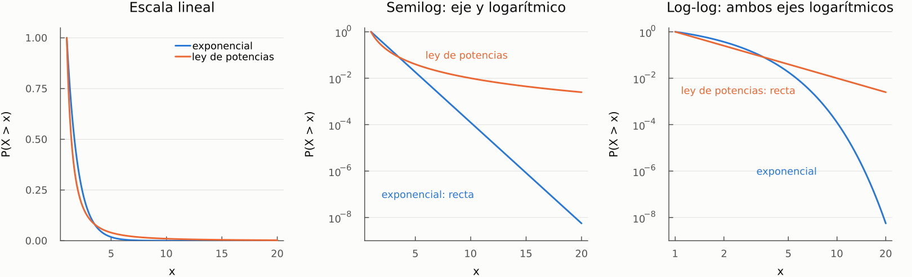
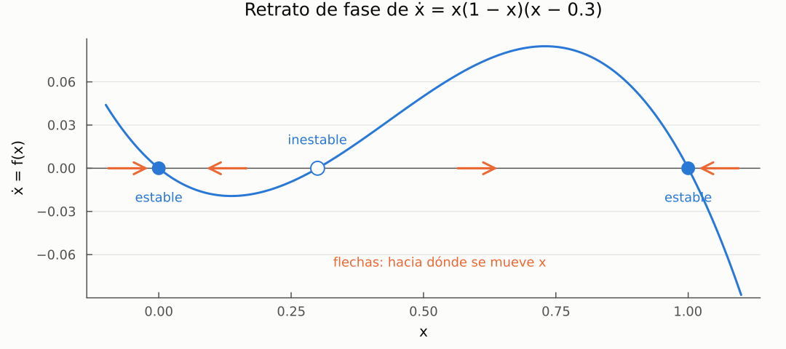
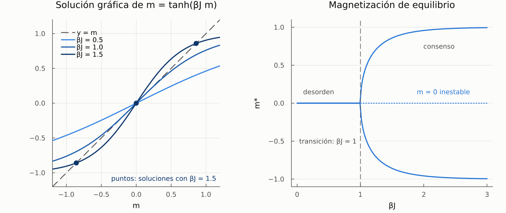
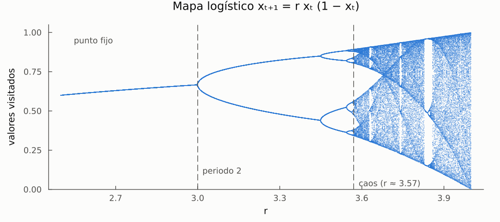

# Repaso: cálculo y ecuaciones diferenciales

> Cada concepto tiene una clave (por ejemplo **[C.I4](#ci4)**) y dice en qué sesiones
> se usa. El índice [README.md](README.md) indica qué repasar antes de cada
> sesión. Los fragmentos de Julia corren en el entorno del curso
> (`julia --project=Code`).
>
> - **Básico**: lo necesario para la ruta básica.
> - **Intermedio**: lo necesario para leer las notas formales.
> - **Avanzado**: lo necesario para la ruta avanzada.

---

## Nivel básico

<a id="cb1"></a>

### C.B1 Exponenciales y logaritmos
*Sesiones 1, 3, 6, 8.*

El **logaritmo natural** $\ln x$ (en Julia, `log(x)`) es la inversa de
$e^x$: $\ln e^x = x$ y $e^{\ln x} = x$ para $x > 0$.

| Regla | Ejemplo en el curso |
|---|---|
| $\ln(ab) = \ln a + \ln b$ | Un producto de factores de crecimiento se vuelve una suma (sesión 6) |
| $\ln(a/b) = \ln a - \ln b$ | Retorno logarítmico $r_t = \ln P_t - \ln P_{t-1}$ (sesión 1) |
| $\ln(a^b) = b\ln a$ | Una ley de potencias $y = Cx^{-\alpha}$ se vuelve $\ln y = \ln C - \alpha\ln x$ (sesión 3) |
| $e^{a+b} = e^a e^b$ | Factores de Boltzmann $e^{-\beta E}$ (sesiones 8 y 13) |
| $\log_{10} x = \ln x / \ln 10$ | Ejes de las gráficas: cambiar de base sólo reescala |

- $\ln x$ crece muy despacio: $\ln 10^6 \approx 13.8$. Por eso comprime
  datos que abarcan muchos órdenes de magnitud (riqueza, tamaños de ciudad).
- $e^{-x}$ decae muy rápido: $e^{-10} \approx 4.5 \times 10^{-5}$.
- **Crecimiento exponencial**: $x(t) = x_0 e^{gt}$ duplica su valor cada
  $\ln 2/g \approx 0.69/g$ unidades de tiempo.

<a id="cb2"></a>

### C.B2 Gráficas en escala logarítmica
*Sesiones 1, 3, 6, 8, 10.*

Elegir bien la escala permite **reconocer la forma** de una relación:

| Si los datos siguen… | …se ven rectos en | Pendiente |
|---|---|---|
| $y = a + bx$ | escala lineal | $b$ |
| $y = Ce^{-\lambda x}$ (exponencial) | **semilog**: eje $y$ logarítmico | $-\lambda$ |
| $y = Cx^{-\alpha}$ (ley de potencias) | **log-log**: ambos ejes logarítmicos | $-\alpha$ |



*La misma exponencial y la misma ley de potencias en tres escalas. Cada una se vuelve recta sólo en su escala: semilog para la exponencial, log-log para la ley de potencias.*


Para estimar la pendiente en log-log a partir de dos puntos:
$-\alpha = \dfrac{\ln y_2 - \ln y_1}{\ln x_2 - \ln x_1}$. Si la recta baja
dos órdenes de magnitud en $y$ mientras $x$ sube uno, $\alpha = 2$.

**Cuidado:** casi cualquier curva parece recta en un rango corto de una
gráfica log-log. Hace falta al menos uno o dos órdenes de magnitud en $x$,
y en la sesión 3 veremos métodos más confiables que ajustar una recta.

<a id="cb3"></a>

### C.B3 La derivada como tasa de cambio
*Sesiones 5, 8, 13, 17.*

$$
f'(x) = \frac{df}{dx} = \lim_{h \to 0}\frac{f(x+h) - f(x)}{h}.
$$

Es la **pendiente** de la curva en $x$: cuánto cambia $f$ por unidad de
cambio en $x$. Si $x$ es el tiempo, es una **velocidad** o tasa de
crecimiento.

| $f(x)$ | $f'(x)$ |
|---|---|
| $x^n$ | $n x^{n-1}$ |
| $e^{ax}$ | $a e^{ax}$ |
| $\ln x$ | $1/x$ |

Reglas: $(f + g)' = f' + g'$; $(fg)' = f'g + fg'$; **regla de la cadena**:
$\big(f(g(x))\big)' = f'(g(x))\thinspace g'(x)$.

- $f' > 0$: $f$ crece. $f' < 0$: decrece.
- En un máximo o mínimo interior, $f'(x) = 0$; $f'' < 0$ indica máximo y
  $f'' > 0$ mínimo.
- **Tasa de crecimiento relativa**: $\frac{d}{dt}\ln x(t) = \dot x/x$. Es la
  versión continua del retorno logarítmico.

<a id="cb4"></a>

### C.B4 Funciones que reaparecen en el curso
*Sesiones 8, 13, 15, 18.*

**Función logística.**

$$
\sigma(x) = \frac{1}{1 + e^{-x}} \in (0, 1),
\qquad
\sigma'(x) = \sigma(x)\big(1 - \sigma(x)\big),
\qquad
\sigma(-x) = 1 - \sigma(x).
$$

Convierte cualquier número en una probabilidad. En el **modelo logit** de
elección discreta, la probabilidad de elegir A sobre B es
$\sigma\big(\beta(u_A - u_B)\big)$: con $\beta$ grande la elección es casi
determinista; con $\beta = 0$, al azar (sesión 13).

**Tangente hiperbólica.**

$$
\tanh x = \frac{e^x - e^{-x}}{e^x + e^{-x}} = 2\sigma(2x) - 1 \in (-1, 1).
$$

Es la logística reescalada al intervalo $(-1, 1)$: la magnetización media
de un espín (o la opinión media de un agente) bajo un campo $x$.
Cerca de 0, $\tanh x \approx x$.

**Exponencial decreciente** $e^{-x/x_0}$: decaimiento con escala
característica $x_0$ (autocorrelaciones, distribución de Boltzmann).

<a id="cb5"></a>

### C.B5 Sumatorias y la serie geométrica
*Sesiones 4, 10, 12.*

$\sum_{i=1}^n a_i = a_1 + \cdots + a_n$. Propiedades:
$\sum (a_i + b_i) = \sum a_i + \sum b_i$ y $\sum c\thinspace a_i = c\sum a_i$.

**Serie geométrica.** Para $q \ne 1$,

$$
\sum_{k=0}^{n-1} q^k = \frac{1 - q^n}{1 - q},
\qquad
\sum_{k=0}^{\infty} q^k = \frac{1}{1-q} \quad \text{si } |q| < 1.
$$

Aparece cada vez que un efecto se repite atenuándose: la varianza de un
AR(1), que es $\sigma^2\sum_k \phi^{2k} = \sigma^2/(1-\phi^2)$; la propagación de
un choque en una red ([L.A4](algebra_lineal.md#la4)), el valor presente de un flujo descontado.

<a id="cb6"></a>

### C.B6 La integral como área
*Sesiones 1, 3, 8.*

En el nivel básico basta con una idea: $\int_a^b f(x)\thinspace dx$ es el
**área bajo la curva** $f$ entre $a$ y $b$. Se aproxima partiendo
$[a, b]$ en intervalos de ancho $\Delta x$ y sumando rectángulos:

$$
\int_a^b f(x)\thinspace dx \approx \sum_k f(x_k)\thinspace\Delta x.
$$

Es exactamente lo que hace un histograma normalizado ([P.B3](probabilidad.md#pb3)): cada barra es
un rectángulo de alto $f(x_k)$ y ancho $\Delta x$, y su área es la fracción
de datos en ese intervalo.

Para leer el curso necesitas reconocer tres usos:

| Expresión | Se lee | Análogo discreto |
|---|---|---|
| $\int_a^b f(x)\thinspace dx$ con $f$ una densidad | Probabilidad de caer entre $a$ y $b$ | $\sum_{k=a}^{b} p(k)$ |
| $\int f(x)\thinspace dx = 1$ | Las probabilidades suman 1 | $\sum_k p(k) = 1$ |
| $\int x f(x)\thinspace dx$ | Promedio ponderado por la densidad: la media | $\sum_k k\thinspace p(k)$ |

Cómo **calcular** integrales está en [C.I2](#ci2); en la ruta básica las calcula la
computadora.

```julia
f(x) = exp(-x^2 / 2) / sqrt(2π)          # densidad normal estándar
Δx = 0.001; xs = -1:Δx:1
sum(f.(xs[1:end-1])) * Δx                # ≈ 0.683: P(-1 < Z < 1)
```

---

## Nivel intermedio

<a id="ci1"></a>

### C.I1 Desarrollo de Taylor
*Sesiones 1, 5, 14, 17.*

Cerca de un punto $a$, una función suave se aproxima por un polinomio:

$$
f(x) = f(a) + f'(a)(x-a) + \frac{f''(a)}{2}(x-a)^2 + \cdots
$$

Desarrollos que usamos (alrededor de 0):

$$
e^x \approx 1 + x + \frac{x^2}{2},
\qquad
\ln(1+x) \approx x - \frac{x^2}{2},
\qquad
\tanh x \approx x - \frac{x^3}{3},
\qquad
\frac{1}{1-x} \approx 1 + x.
$$

Usos en el curso:

- **Primer orden (linealización)**: $r_t = \ln(1+R_t) \approx R_t$
  ([sesión 1](../s01_retornos.md)); estabilidad de puntos fijos ([C.I4](#ci4), [L.A3](algebra_lineal.md#la3)).
- **Segundo orden**: el término $-\sigma^2/2$ del lema de Itô ([E.A2](procesos_estocasticos.md#ea2)); la
  diferencia entre retorno simple y logarítmico.
- **Tercer orden**: $\tanh(\beta J m) \approx \beta J m - (\beta J m)^3/3$
  explica la forma de la transición de fase de campo medio (sesión 14).

El error de cortar en el orden $n$ es del orden de $(x-a)^{n+1}$: si
$x - a$ es pequeño, el siguiente término es mucho más pequeño.

<a id="ci2"></a>

### C.I2 Integrales
*Sesiones 1, 3, 5, 8.*

$\int_a^b f(x)\thinspace dx$ es el área bajo $f$ entre $a$ y $b$, o la **acumulación**
de una tasa: si $f$ es una velocidad, la integral es la distancia recorrida.

**Teorema fundamental del cálculo**: si $F' = f$, entonces
$\int_a^b f(x)\thinspace dx = F(b) - F(a)$. Así se relacionan la densidad y la CDF
([P.B1](probabilidad.md#pb1)).

Integrales que aparecen:

- **Gaussiana**: $\int_{-\infty}^{\infty} e^{-x^2/2}\thinspace dx = \sqrt{2\pi}$
  (constante de normalización de la normal).
- **Exponencial**: $\int_0^\infty e^{-\lambda x}\thinspace dx = 1/\lambda$.
- **Potencias**: para $x_m > 0$,
  $\int_{x_m}^{\infty} x^{-a}\thinspace dx = x_m^{1-a}/(a-1)$ si $a > 1$, y la
  integral diverge si $a \le 1$. Este resultado decide qué momentos de una ley de potencias existen: con
  densidad $\propto x^{-(\alpha+1)}$, $\mathbb{E}[X^n] = \int x^{n-\alpha-1}dx$
  es finito sólo si $n < \alpha$ ([P.I5](probabilidad.md#pi5)).

**Integración por partes**: $\int u\thinspace dv = uv - \int v\thinspace du$. Se usa para
calcular momentos de la normal ([notas de la sesión 1](../s01_retornos.md)).

<a id="ci3"></a>

### C.I3 Funciones de varias variables
*Sesiones 7, 8, 17.*

Si $f(x_1, \dots, x_n)$, la **derivada parcial** $\partial f/\partial x_i$
se calcula derivando respecto a $x_i$ con las demás variables fijas.

- **Gradiente**: $\nabla f = (\partial f/\partial x_1, \dots, \partial f/\partial x_n)$.
  Apunta en la dirección de máximo crecimiento de $f$.
- En un máximo o mínimo interior, $\nabla f = 0$.
- **Jacobiano** de una función vectorial $F: \mathbb{R}^n \to \mathbb{R}^n$:
  la matriz $J_{ij} = \partial F_i/\partial x_j$ ([L.A3](algebra_lineal.md#la3)).

Ejemplo: $f(x, y) = x^2 y + e^y$ tiene $\partial_x f = 2xy$ y
$\partial_y f = x^2 + e^y$.

<a id="ci4"></a>

### C.I4 Ecuaciones diferenciales en una dimensión
*Sesiones 5, 9, 17.*

Una **ecuación diferencial ordinaria** (EDO) $\dot x = dx/dt = f(x)$ dice
cómo cambia $x$ dependiendo de su valor actual.

**Como regla de actualización (método de Euler).** Con paso $\Delta t$:

$$
x_{k+1} = x_k + f(x_k)\thinspace\Delta t.
$$

Así se simula en el curso: es la misma idea que en un modelo de agentes,
pero con pasos pequeños. El error es proporcional a $\Delta t$.

**Dos ejemplos con solución exacta:**

| EDO | Solución | Comportamiento |
|---|---|---|
| $\dot x = gx$ | $x_0 e^{gt}$ | Crece ($g > 0$) o decae ($g < 0$) exponencialmente |
| $\dot x = rx(1 - x/K)$ (logística) | $\dfrac{K}{1 + \frac{K - x_0}{x_0}e^{-rt}}$ | Crece en forma de S hasta la capacidad $K$ |

**Puntos fijos y estabilidad.** $x^\ast$ es un punto fijo si $f(x^\ast) = 0$. Es
**estable** si $f'(x^\ast) < 0$ (una perturbación pequeña decae como
$e^{f'(x^\ast)t}$) e inestable si $f'(x^\ast) > 0$. En la logística,
$f'(0) = r > 0$ (inestable) y $f'(K) = -r < 0$ (estable).

**Retrato de fase.** Sin resolver nada: graficar $f(x)$; donde $f > 0$, $x$
se mueve a la derecha; donde $f < 0$, a la izquierda. Los puntos fijos son
los cruces con cero.



*Donde f(x) > 0, x crece; donde f(x) < 0, decrece. Los puntos fijos con pendiente negativa (0 y 1) atraen; el de pendiente positiva (0.3) repele.*

```julia
f(x) = 0.5 * x * (1 - x / 100)                   # logística con r = 0.5, K = 100
function euler(f, x0, Δt, n)
    x = zeros(n + 1); x[1] = x0
    for k in 1:n; x[k+1] = x[k] + f(x[k]) * Δt; end
    x
end
x = euler(f, 1.0, 0.1, 400)                       # 40 unidades de tiempo
exacta(t) = 100 / (1 + 99 * exp(-0.5t))
x[end], exacta(40.0)                              # ≈ 100 y 100
```

<a id="ci5"></a>

### C.I5 Ecuaciones de punto fijo y solución gráfica
*Sesiones 12, 14, 20.*

Muchos modelos de campo medio terminan en una ecuación $x = g(x)$. Ejemplo
central: la magnetización (u opinión promedio) del modelo de Ising en campo
medio,

$$
m = \tanh(\beta J m).
$$

**Solución gráfica.** Graficar $y = x$ y $y = g(x)$; las soluciones son las
intersecciones. Para $\tanh(\beta J m)$, la pendiente en el origen es
$\beta J$:

- $\beta J < 1$: sólo $m = 0$ (desorden, opiniones mezcladas).
- $\beta J > 1$: aparecen dos soluciones más, $\pm m^\ast  \ne 0$ (consenso
  espontáneo). La **transición de fase** ocurre en $\beta J = 1$.

**Solución por iteración.** $x_{k+1} = g(x_k)$ converge a $x^\ast$ si
$|g'(x^\ast)| < 1$ cerca del punto fijo.



*Izquierda: las soluciones son los cruces de y = m con tanh(βJ m); con βJ > 1 aparecen dos cruces nuevos. Derecha: la magnetización de equilibrio en función de βJ; la rama m = 0 se vuelve inestable en βJ = 1.*

```julia
function punto_fijo(g, x0; tol = 1e-12, maxit = 10_000)
    x = x0
    for _ in 1:maxit
        xn = g(x); abs(xn - x) < tol && return xn; x = xn
    end
    x
end
[punto_fijo(m -> tanh(βJ * m), 0.9) for βJ in (0.5, 1.5, 2.0)]   # ≈ 0, 0.86, 0.96
```

<a id="ci6"></a>

### C.I6 Notación asintótica
*Todas las sesiones.*

- $f(x) \sim g(x)$: $f/g \to 1$ en el límite indicado. Por ejemplo,
  $\bar F(x) \sim Cx^{-\alpha}$ cuando $x \to \infty$ dice cómo se comporta
  la cola, no el centro.
- $f = O(g)$: $f$ no crece más rápido que una constante por $g$. "El error
  de Euler es $O(\Delta t)$."
- $x \ll y$: $x$ es mucho menor que $y$ (por un orden de magnitud o más).
- **Término dominante**: en $n^2 + 100n$, para $n$ grande domina $n^2$.

---

## Nivel avanzado

<a id="ca1"></a>

### C.A1 Optimización con restricciones: multiplicadores de Lagrange
*Sesión 8.*

Para maximizar $f(x)$ sujeto a $g_j(x) = c_j$, se construye el
**lagrangiano**

$$
\mathcal{L}(x, \lambda) = f(x) - \sum_j \lambda_j\big(g_j(x) - c_j\big)
$$

y se resuelve $\nabla_x \mathcal{L} = 0$ junto con las restricciones. En
el óptimo, $\lambda_j$ mide cuánto mejora $f$ si se relaja la restricción
$j$ (el **precio sombra** en economía).

**Ejemplo: máxima entropía.** Maximizar $S = -\sum_i p_i\ln p_i$ sujeto a
$\sum_i p_i = 1$ y $\sum_i p_i\thinspace\varepsilon_i = E$:

$$
\frac{\partial\mathcal{L}}{\partial p_i} = -\ln p_i - 1 - \lambda_0 - \beta\thinspace\varepsilon_i = 0
\quad\Longrightarrow\quad
p_i = \frac{e^{-\beta\varepsilon_i}}{Z},
\qquad Z = \sum_i e^{-\beta\varepsilon_i}.
$$

Es la **distribución de Boltzmann-Gibbs**. Con dinero $m \ge 0$ en lugar de
energía, la versión continua da la exponencial $p(m) = e^{-m/T}/T$, con
"temperatura" $T = \langle m \rangle$: el dinero promedio por agente
(Dragulescu-Yakovenko, sesión 8).

<a id="ca2"></a>

### C.A2 Sistemas de EDO en dos dimensiones
*Sesión 17.*

$$
\dot x = f(x, y), \qquad \dot y = g(x, y).
$$

- **Ceroclinas**: las curvas $f = 0$ (donde $x$ no cambia) y $g = 0$. Sus
  intersecciones son los puntos fijos.
- La estabilidad se decide con los eigenvalores del jacobiano ([L.A3](algebra_lineal.md#la3)).

**Lotka-Volterra** (presa $x$, depredador $y$):

$$
\dot x = ax - bxy, \qquad \dot y = -cy + dxy.
$$

Punto fijo interior $(c/d,\thinspace a/b)$. La cantidad
$V = dx - c\ln x + by - a\ln y$ se conserva ($\dot V = 0$), así que las
trayectorias son **órbitas cerradas**: ciclos perpetuos. En el **ciclo de
Goodwin**, la tasa de empleo hace el papel de la presa y la participación
salarial el del depredador.

**Dinámica del replicador.** Con dos estrategias, si $x$ es la fracción que
usa la estrategia 1 y $\pi_1, \pi_2$ son los pagos,

$$
\dot x = x(1 - x)\big(\pi_1(x) - \pi_2(x)\big).
$$

Una estrategia crece si le va mejor que al promedio. En Halcón-Paloma hay
un punto fijo interior estable: la mezcla de equilibrio.

<a id="ca3"></a>

### C.A3 Ecuaciones en derivadas parciales: difusión
*Sesiones 4, 5, 9.*

Cuando la incógnita depende de dos variables, como una densidad $p(x, t)$,
la ecuación involucra derivadas parciales.

**Ecuación de continuidad.** Si $J(x, t)$ es el flujo de probabilidad,

$$
\frac{\partial p}{\partial t} + \frac{\partial J}{\partial x} = 0.
$$

"Lo que se acumula en un punto es lo que entra menos lo que sale."

**Ecuación de difusión (del calor).** Con $J = -D\thinspace\partial p/\partial x$:

$$
\frac{\partial p}{\partial t} = D\frac{\partial^2 p}{\partial x^2},
\qquad
p(x, t) = \frac{1}{\sqrt{4\pi D t}}\exp\negthinspace\left(-\frac{x^2}{4Dt}\right)
\text{ si } p(x, 0) = \delta(x).
$$

La solución es una normal con varianza $2Dt$: crece linealmente en el
tiempo, como la caminata aleatoria ([E.B2](procesos_estocasticos.md#eb2)). Una caminata con pasos $\pm a$
cada $\tau$ unidades de tiempo tiene $D = a^2/2\tau$. Añadir una deriva da
la ecuación de Fokker-Planck ([E.A4](procesos_estocasticos.md#ea4)).

<a id="ca4"></a>

### C.A4 Función gamma y fórmula de Stirling
*Sesiones 8, 9, 14.*

**Función gamma**: $\Gamma(z) = \int_0^\infty t^{z-1}e^{-t}\thinspace dt$. Cumple
$\Gamma(z+1) = z\thinspace\Gamma(z)$, de modo que $\Gamma(n) = (n-1)!$ para enteros;
además $\Gamma(1/2) = \sqrt\pi$. Normaliza la distribución gamma ([P.I4](probabilidad.md#pi4)) del
modelo con ahorro.

**Fórmula de Stirling**: para $n$ grande,

$$
\ln n! \approx n\ln n - n.
$$

**Aplicación: de contar a la entropía.** El número de formas de repartir $N$
agentes en estados con ocupaciones $n_1, n_2, \dots$ es
$W = N!/\prod_i n_i!$. Con Stirling y $p_i = n_i/N$:

$$
\ln W \approx -N\sum_i p_i\ln p_i.
$$

Maximizar el número de configuraciones es maximizar la entropía: ésta es la
justificación combinatoria de [C.A1](#ca1).

<a id="ca5"></a>

### C.A5 Mapas discretos, bifurcaciones y caos
*Sesión 20.*

Un **mapa** $x_{t+1} = F(x_t)$ es la versión en tiempo discreto de una EDO.
Los modelos de expectativas (Brock-Hommes) son de este tipo: el precio de
hoy depende de las predicciones hechas con precios pasados.

- **Diagrama de telaraña**: graficar $y = F(x)$ y $y = x$, y alternar pasos
  verticales (aplicar $F$) y horizontales (volver a la diagonal).
- Un punto fijo $x^\ast  = F(x^\ast)$ es estable si $|F'(x^\ast)| < 1$.
- **Mapa logístico** $x_{t+1} = rx_t(1-x_t)$: punto fijo estable hasta
  $r = 3$; ahí $F'(x^\ast) = -1$ y aparece un ciclo de periodo 2; siguen
  duplicaciones de periodo hasta el **caos** en $r \approx 3.57$.
- **Diagrama de bifurcación**: para cada valor del parámetro, graficar los
  valores visitados después del transitorio.
- **Exponente de Lyapunov**:
  $\lambda = \lim_{n\to\infty}\frac1n\sum_{k} \ln|F'(x_k)|$. Si $\lambda > 0$,
  dos condiciones iniciales cercanas se separan exponencialmente: caos.



*Valores que visita el mapa logístico después del transitorio, para cada r. El punto fijo se duplica en r = 3, siguen más duplicaciones y desde r ≈ 3.57 aparece el caos, con ventanas periódicas.*

```julia
using Plots
logistico(r, x) = r * x * (1 - x)
rs = 2.5:0.002:4.0
puntos = [(r, x) for r in rs for x in begin
    x = 0.5; for _ in 1:500; x = logistico(r, x); end          # descarta transitorio
    v = zeros(100); for i in 1:100; x = logistico(r, x); v[i] = x; end; v
end]
scatter(first.(puntos), last.(puntos); ms = 0.5, msw = 0, legend = false)
```

---

## Autodiagnóstico

<details>
<summary><b>1 (B).</b> Simplifica ln(<i>P</i>₃/<i>P</i>₀) en términos de los retornos logarítmicos diarios.</summary>

$\ln(P_3/P_0) = \ln(P_3/P_2) + \ln(P_2/P_1) + \ln(P_1/P_0) = r_3 + r_2 + r_1$.
</details>

<details>
<summary><b>2 (B).</b> En una gráfica log-log, una recta pasa por (10, 10⁻²) y (1000, 10⁻⁶). ¿Cuál es el exponente?</summary>

La pendiente es $(-6 - (-2))/(3 - 1) = -2$, así que $\alpha = 2$.
</details>

<details>
<summary><b>3 (B).</b> Deriva <i>f</i>(<i>x</i>) = ln(1 + <i>e</i><sup><i>x</i></sup>). ¿Qué función conocida obtienes?</summary>

Por la regla de la cadena, $f'(x) = e^x/(1 + e^x) = 1/(1 + e^{-x}) = \sigma(x)$:
la logística.
</details>

<details>
<summary><b>4 (B).</b> En el logit, la probabilidad de elegir A es σ(β(<i>u</i><sub>A</sub> − <i>u</i><sub>B</sub>)). ¿Cuánto vale si las dos utilidades son iguales? ¿Y si β(<i>u</i><sub>A</sub> − <i>u</i><sub>B</sub>) = 2?</summary>

Con utilidades iguales, $\sigma(0) = 1/2$: cualquiera de las dos con igual
probabilidad. Con 2, $\sigma(2) = 1/(1 + e^{-2}) \approx 0.88$.
</details>

<details>
<summary><b>5 (B).</b> Una densidad vale 0.5 en el intervalo [0, 2] y 0 fuera de él. ¿Con qué probabilidad cae <i>X</i> entre 0.5 y 1.5? ¿Es una densidad válida?</summary>

La probabilidad es el área bajo la densidad: $0.5 \times 1 = 0.5$. Es válida
porque es no negativa y su área total es $0.5 \times 2 = 1$.
</details>

<details>
<summary><b>6 (I).</b> ¿Para qué valores de α tiene media finita una densidad ∝ <i>x</i><sup>−(α+1)</sup> en [1, ∞)?</summary>

$\mathbb{E}[X] = \int_1^\infty x \cdot x^{-(\alpha+1)}dx = \int_1^\infty x^{-\alpha}dx$,
finita si y sólo si $\alpha > 1$.
</details>

<details>
<summary><b>7 (I).</b> Encuentra los puntos fijos de ẋ = <i>x</i>(1 − <i>x</i>)(<i>x</i> − 0.3) y decide su estabilidad.</summary>

$x^\ast  = 0, 0.3, 1$. Con $f(x) = x(1-x)(x - 0.3)$: $f'(0) = -0.3 < 0$
(estable), $f'(0.3) = 0.3 \cdot 0.7 > 0$ (inestable), $f'(1) = -0.7 < 0$
(estable). Es un modelo de coordinación: según dónde empiece, la población
termina en 0 o en 1.
</details>

<details>
<summary><b>8 (I).</b> ¿Por qué m = 0 deja de ser estable cuando βJ > 1 en m = tanh(βJm)?</summary>

Con $g(m) = \tanh(\beta J m)$, $g'(0) = \beta J$. Para la iteración, el
punto fijo es estable si $|g'(0)| < 1$; con $\beta J > 1$ deja de serlo y la
iteración se aleja hacia $\pm m^\ast$.
</details>

<details>
<summary><b>9 (A).</b> Maximiza la entropía −∑ <i>p</i><sub><i>i</i></sub> ln <i>p</i><sub><i>i</i></sub> de <i>n</i> estados con la única restricción ∑ <i>p</i><sub><i>i</i></sub> = 1.</summary>

$-\ln p_i - 1 - \lambda_0 = 0$ da $p_i$ constante, es decir, $p_i = 1/n$: sin
más información, la distribución de máxima entropía es la uniforme.
</details>

<details>
<summary><b>10 (A).</b> Verifica que <i>V</i> = <i>dx</i> − <i>c</i> ln <i>x</i> + <i>by</i> − <i>a</i> ln <i>y</i> se conserva en Lotka-Volterra.</summary>

$\dot V = (d - c/x)\dot x + (b - a/y)\dot y = (d - c/x)\thinspace x(a - by) + (b - a/y)\thinspace y(dx - c)$
$= (dx - c)(a - by) + (by - a)(dx - c) = 0$.
</details>

---

## Para profundizar

- Strogatz (2018), caps. 1–6 y 10: EDO, retratos de fase, estabilidad y
  mapas discretos. Muy recomendable para las sesiones 17 y 20.
- Chakrabarti et al. (2013), cap. 2: máxima entropía en distribuciones de
  ingreso.
- Cualquier texto de cálculo (por ejemplo, Stewart, *Cálculo*) para el
  nivel básico.
