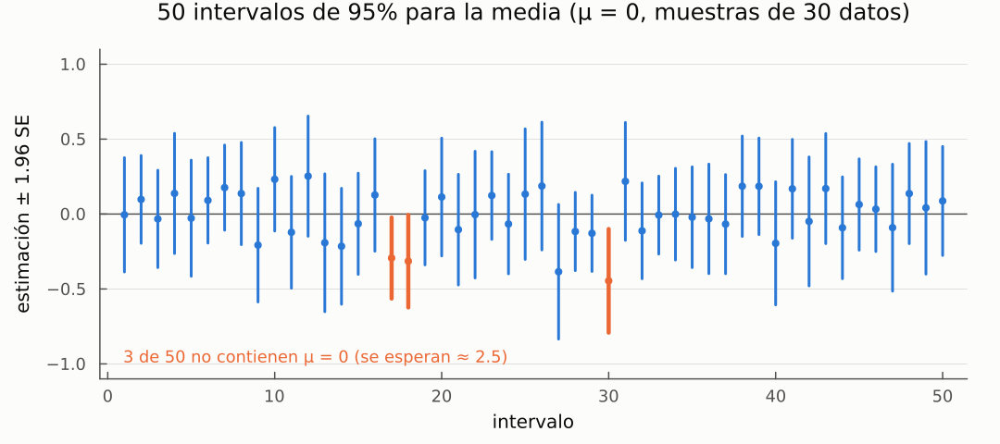

# Repaso: estadística e inferencia

> Cada concepto tiene una clave (por ejemplo [S.I2](#si2)) y dice en qué sesiones
> se usa. El índice [README.md](README.md) indica qué repasar antes de cada
> sesión. Supone el repaso de [probabilidad](probabilidad.md) hasta el nivel
> correspondiente. Los fragmentos de Julia corren en el entorno del curso
> (`julia --project=Code`).
>
> - **Básico**: lo necesario para la ruta básica.
> - **Intermedio**: lo necesario para leer las notas formales.
> - **Avanzado**: lo necesario para la ruta avanzada.
>
> La probabilidad va del modelo a los datos ("si el modelo es así, ¿qué
> datos espero?"). La estadística va al revés: de los datos al modelo.

---

## Nivel básico

<a id="sb1"></a>

### S.B1 Estimadores y su variabilidad
*Sesiones 1 en adelante.*

Un **estimador** es una receta que convierte datos en un número:
$\hat\mu$ (media muestral), $\hat\sigma$, $\hat\kappa$, $\hat\rho(1)$,
$\hat\alpha$. Como los datos son aleatorios, **el estimador también lo es**:
con otra muestra del mismo proceso daría otro valor. Su distribución se
llama **distribución muestral**.

Tres propiedades que importan:

- **Sesgo**: $\mathbb{E}[\hat\theta] - \theta$. Por ejemplo, dividir entre
  $N$ en lugar de $N-1$ subestima la varianza ([P.B5](probabilidad.md#pb5)).
- **Error estándar** $\mathrm{SE}(\hat\theta)$: la desviación estándar de
  la distribución muestral. Para la media, $\sigma/\sqrt{N}$.
- **Consistencia**: $\hat\theta \to \theta$ cuando $N \to \infty$.

**Regla práctica:** todo número calculado con datos debe ir acompañado de su
error estándar. Un exponente $\hat\alpha = 2.9$ sin error no dice si es
compatible con 3.

```julia
using Distributions, Statistics, Random
rng = Xoshiro(1)
medias = [mean(rand(rng, TDist(4), 250)) for _ in 1:5_000]   # 5000 muestras de 250 datos
std(medias), sqrt(var(TDist(4)) / 250)                       # SE simulado ≈ σ/√N ≈ 0.089
```

<a id="sb2"></a>

### S.B2 Intervalos de confianza
*Sesiones 1, 3, 8.*

Si la distribución muestral es aproximadamente normal (lo usual cuando $N$
es grande, por el TLC), un **intervalo de confianza del 95%** es

$$
\hat\theta \pm 1.96\thinspace\mathrm{SE}(\hat\theta).
$$

**Cómo se interpreta.** Si repitiéramos el experimento muchas veces, el 95%
de los intervalos así construidos contendría el valor verdadero. No es
correcto decir "hay 95% de probabilidad de que $\theta$ esté en este
intervalo": $\theta$ es fijo; lo aleatorio es el intervalo.



*Cada barra es un intervalo construido con una muestra distinta. Cerca del 5% no contienen el valor verdadero: eso, y nada más, significa «95% de confianza».*

**Ejemplo: la media se estima mal; la volatilidad, bien.** Con 6000 días y
volatilidad diaria $\sigma = 0.012$ (1.2%), el error estándar de la media es
$0.012/\sqrt{6000} \approx 0.00015$. Si el retorno medio estimado es
0.03% diario, el intervalo es 0.03% ± 0.03%: apenas se distingue de cero,
después de 24 años de datos. En cambio, $\hat\sigma$ se conoce con un error
relativo de pocos por ciento. Por eso la econofísica se concentra en
volatilidades, colas y correlaciones, y no en predecir retornos medios.

La banda $\pm 1.96/\sqrt{N}$ de la autocorrelación ([sesión 1](../s01_retornos.md)) es un
intervalo de este tipo, construido bajo la hipótesis de independencia.

```julia
using Statistics, Random
r = 0.0003 .+ 0.012 .* randn(Xoshiro(2), 6_000)     # retornos diarios ficticios
se = std(r) / sqrt(length(r))
mean(r) - 1.96se, mean(r) + 1.96se                 # intervalo de 95% para la media
```

<a id="sb3"></a>

### S.B3 Pruebas de hipótesis y p-valores
*Sesiones 1, 3, 7.*

Una **prueba de hipótesis** pregunta si los datos son compatibles con una
afirmación concreta, la **hipótesis nula** $H_0$. Por ejemplo, que
$\rho(1) = 0$, o que los retornos son normales.

1. Elegir un **estadístico** $T$ que mida qué tan lejos están los datos de
   $H_0$.
2. Calcular su distribución **suponiendo que $H_0$ es cierta**.
3. El **p-valor** es la probabilidad, bajo $H_0$, de obtener un $T$ tan
   extremo o más que el observado.
4. Si $p < 0.05$, se **rechaza** $H_0$ al nivel de 5%.

Errores posibles: rechazar una $H_0$ verdadera (**tipo I**, ocurre con
probabilidad 5% por construcción) o no rechazar una falsa (**tipo II**). La
probabilidad de detectar una $H_0$ falsa se llama **potencia** y crece con
$N$.

**Tres malas lecturas frecuentes:**

- El p-valor **no** es la probabilidad de que $H_0$ sea cierta.
- **Significativo no es lo mismo que importante.** Con $N = 6000$, una
  autocorrelación de 0.08 es muy significativa ($z = \sqrt{N}\hat\rho \approx 6$),
  pero explica menos del 1% de la varianza del día siguiente.
- **No rechazar no es confirmar.** Puede que simplemente falten datos.

**Ejemplo: ¿son normales los retornos?** La prueba de Jarque-Bera combina
asimetría $\hat\gamma$ y curtosis en exceso $\hat\kappa$:

$$
JB = \frac{N}{6}\left(\hat\gamma^2 + \frac{\hat\kappa^2}{4}\right),
$$

que bajo normalidad sigue una $\chi^2$ con 2 grados de libertad. Con
$N = 6000$ y $\hat\kappa = 10$, $JB = 25000$: el p-valor es
prácticamente cero.

```julia
using StatsBase, Distributions, Random
r = rand(Xoshiro(3), TDist(4), 6_000)
N = length(r)
JB = N / 6 * (skewness(r)^2 + kurtosis(r)^2 / 4)
ccdf(Chisq(2), JB)                                   # p-valor ≈ 0: no es normal
z = sqrt(N) * autocor(r, [1])[1]
2 * ccdf(Normal(), abs(z))                           # p-valor de H0: ρ(1) = 0
```

<a id="sb4"></a>

### S.B4 Mínimos cuadrados
*Sesiones 3, 6, 10, proyecto final.*

Para ajustar una recta $y_i = a + b\thinspace x_i + e_i$ a datos
$(x_i, y_i)$, **mínimos cuadrados ordinarios** (MCO) elige $a$ y $b$ que
minimizan $\sum_i e_i^2$. La solución es

$$
\hat b = \frac{\mathrm{Cov}(x, y)}{\mathrm{Var}(x)},
\qquad
\hat a = \bar y - \hat b\thinspace\bar x.
$$

- El **coeficiente de determinación** $R^2$ es la fracción de la varianza
  de $y$ que explica la recta. En regresión simple, $R^2 = \rho_{xy}^2$.
- **En escala log-log**, la pendiente es una **elasticidad**: en
  $\ln y = a + b\ln x$, si $x$ sube 1%, $y$ sube aproximadamente $b$%.
- Es la herramienta natural para estimar pendientes en gráficas log-log,
  pero **para exponentes de colas da resultados sesgados** ([S.I3](#si3)).

```julia
using Statistics, Random
rng = Xoshiro(4)
x = randn(rng, 200); y = 1.0 .+ 0.5 .* x .+ 0.3 .* randn(rng, 200)
X = [ones(200) x]
â, b̂ = X \ y                     # mínimos cuadrados: ≈ 1.0 y 0.5
b̂ ≈ cov(x, y) / var(x)           # true
R² = cor(x, y)^2
```

<a id="sb5"></a>

### S.B5 Pruebas por simulación: permutaciones
*Sesiones 2, 7, 20.*

Cuando no conocemos la distribución de un estadístico bajo $H_0$, podemos
**simularla**. Si $H_0$ dice que el orden temporal no importa, barajar los
datos genera muestras compatibles con $H_0$:

1. Calcular el estadístico con los datos reales: $T_{\text{obs}}$.
2. Barajar los datos $M$ veces y calcular $T$ en cada versión barajada.
3. El p-valor es la fracción de versiones barajadas con $T \ge T_{\text{obs}}$:
   $p = (1 + \text{número de } T \ge T_{\text{obs}})/(1 + M)$.

Es la versión formal de los modelos nulos de la [sesión 2](../s01_retornos.md). La misma idea
aparece en la sesión 7, donde el espectro de la matriz de correlación
barajada indica qué es ruido.

```julia
using Random, StatsBase
rng = Xoshiro(5)
logσ = zeros(5_000)
for t in 2:5_000; logσ[t] = 0.98logσ[t-1] + 0.15randn(rng); end
r = exp.(logσ) .* randn(rng, 5_000)                  # serie con volatilidad estocástica
obs = autocor(abs.(r), [1])[1]
perm = [autocor(abs.(shuffle(rng, r)), [1])[1] for _ in 1:999]
(1 + count(≥(obs), perm)) / (1 + length(perm))       # p-valor = 0.001: el orden importa
```

---

## Nivel intermedio

<a id="si1"></a>

### S.I1 Bootstrap
*Sesiones 3, 8, proyecto final.*

¿Cuál es el error estándar de la curtosis, del índice de Gini o del
exponente de Hill? Muchas veces no hay fórmula. El **bootstrap** (Efron,
1979) lo estima remuestreando los propios datos:

1. Sacar $N$ datos **con reemplazo** de la muestra original.
2. Calcular el estadístico en esa remuestra: $\hat\theta^{\ast}_b$.
3. Repetir $B$ veces (por ejemplo, $B = 2000$).
4. El error estándar es la desviación estándar de los
   $\hat\theta^{\ast}_b$; el intervalo de 95% va del percentil 2.5 al 97.5.

**Cuándo falla:**

- **Series de tiempo.** Remuestrear días sueltos destruye el agrupamiento de
  volatilidad y subestima el error. Solución: **bootstrap por bloques**,
  remuestrear bloques de $\ell$ días consecutivos (con $\ell$ mayor que la
  memoria del proceso).
- **Colas muy pesadas.** Si la varianza es infinita, el bootstrap de la
  media no funciona; tampoco el de estadísticos extremos como el máximo.

```julia
using Random, StatsBase, Distributions
rng = Xoshiro(6)
x = rand(rng, TDist(5), 2_000)                       # curtosis teórica: 6
boot = [kurtosis(sample(rng, x, length(x); replace = true)) for _ in 1:2_000]
kurtosis(x), std(boot), quantile(boot, [0.025, 0.975])
# ≈ 3.7, error 1.1, intervalo [1.5, 5.9]: ni siquiera incluye el 6 verdadero.
# Con colas pesadas, la curtosis y su bootstrap son poco confiables.
```

<a id="si2"></a>

### S.I2 Muchas pruebas a la vez
*Sesiones 1, 7, 20.*

Si hacemos $m$ pruebas independientes al 5% y todas las $H_0$ son ciertas,
la probabilidad de al menos un falso positivo es $1 - 0.95^m$: 64% con
$m = 20$. Por eso, en un correlograma con 30 rezagos, que una o dos barras
salgan de la banda no es evidencia de nada.

Dos soluciones:

- **Bonferroni**: exigir $p < 0.05/m$ a cada prueba. Simple y conservador.
- **Una prueba conjunta.** Para la autocorrelación, el estadístico de
  **Ljung-Box** resume los primeros $m$ rezagos:
  $Q_{LB} = N(N+2)\sum_{\tau=1}^m \hat\rho(\tau)^2/(N-\tau)$, que bajo
  independencia sigue una $\chi^2$ con $m$ grados de libertad. Ojo: aplicada
  a retornos rechaza con frecuencia aunque no haya autocorrelación lineal,
  porque el agrupamiento de volatilidad viola la independencia que supone.
  Sirve sin problema para detectar memoria en $\lvert r\rvert$.

```julia
using StatsBase, Distributions
function ljung_box(x, m)
    N = length(x); ρ = autocor(x, 1:m)
    Q = N * (N + 2) * sum(ρ[τ]^2 / (N - τ) for τ in 1:m)
    Q, ccdf(Chisq(m), Q)                             # estadístico y p-valor
end
ljung_box(r, 20), ljung_box(abs.(r), 20)             # con la serie r de S.B5
# Ambas rechazan, aunque r no tiene autocorrelación lineal: la prueba supone
# independencia, y con volatilidad estocástica exagera la significancia (S.I4).
```

<a id="si3"></a>

### S.I3 Comparar datos con una distribución
*Sesiones 3, 8, 10.*

**Gráfica Q-Q.** Grafica los cuantiles de los datos contra los de una
distribución teórica. Si el modelo es correcto, los puntos caen sobre una
recta. Una forma de S (puntos que se alejan hacia arriba a la derecha y
hacia abajo a la izquierda) indica **colas más pesadas** que las del modelo.

**Por qué no ajustar una recta en log-log para estimar $\alpha$.** Es
tentador: la CCDF de una ley de potencias es una recta en log-log, así que
MCO daría la pendiente. Pero (Clauset, Shalizi & Newman, 2009):

1. Los puntos de la CCDF empírica no son independientes, y los del
   histograma en la cola tienen muy pocos datos.
2. El resultado depende de los bins y del rango elegido.
3. El $R^2$ sale alto incluso con datos lognormales: no sirve para decidir
   si hay ley de potencias.
4. Los errores estándar de MCO no son válidos.

**La receta correcta:** estimar $\alpha$ por máxima verosimilitud ([P.A3](probabilidad.md#pa3)),
elegir $x_{\min}$ minimizando la distancia de Kolmogorov-Smirnov ([P.A4](probabilidad.md#pa4)),
obtener el error por bootstrap ([S.I1](#si1)) y comparar contra alternativas como la
lognormal ([S.A2](#sa2)).

```julia
using StatsPlots, Distributions, Random
x = rand(Xoshiro(7), TDist(3), 2_000)
qqplot(Normal(mean(x), std(x)), x)       # forma de S: colas más pesadas que la normal
```

<a id="si4"></a>

### S.I4 Datos dependientes y tamaño efectivo de muestra
*Sesiones 1, 5, 19, 20.*

La fórmula $\mathrm{SE} = \sigma/\sqrt{N}$ supone datos independientes. Con
datos autocorrelacionados, cada observación nueva aporta menos información.
Para un AR(1) con coeficiente $\phi$, el **tamaño efectivo de muestra** es
aproximadamente

$$
N_{\text{ef}} = N\thinspace\frac{1-\phi}{1+\phi}.
$$

Con $\phi = 0.9$, 10 000 datos valen lo que unos 500 independientes.

Dónde aparece en el curso:

- **Promedios temporales de simulaciones** ([E.B3](procesos_estocasticos.md#eb3)): las series de un modelo
  de agentes suelen ser muy persistentes. El error real del promedio es
  mucho mayor que $\sigma/\sqrt{N}$. Promediar sobre corridas
  independientes evita el problema.
- **Ventanas superpuestas.** Si se calculan retornos de 20 días con ventanas
  que avanzan un día, dos retornos consecutivos comparten 19 días y están
  correlacionados por construcción. Para la normalidad agregacional, usar
  ventanas sin traslape.
- **No estacionariedad.** Si las propiedades cambian con el tiempo, ningún
  $N$ basta. Una buena práctica es repetir el análisis en subperiodos y
  comprobar que el resultado se mantiene.

<a id="si5"></a>

### S.I5 Supuestos de la regresión
*Sesiones 3, 6, proyecto final.*

Los errores estándar e intervalos de MCO suponen que:

1. **El error no depende de $x$** ($\mathbb{E}[e \mid x] = 0$). Falla si hay
   variables omitidas que afectan a $x$ y a $y$: entonces $\hat b$ no mide
   un efecto causal. Correlación no es causalidad.
2. **Varianza constante** (homocedasticidad). Falla con agrupamiento de
   volatilidad. Solución: errores estándar robustos (White).
3. **Errores independientes.** Falla en series de tiempo. Solución: errores
   estándar HAC (Newey & West, 1987).
4. **Sin valores extremos dominantes.** MCO minimiza cuadrados: un solo día
   de crisis puede mover la pendiente. Con colas pesadas, revisar si el
   resultado sobrevive al quitar los extremos.

---

## Nivel avanzado

<a id="sa1"></a>

### S.A1 Máxima verosimilitud: propiedades
*Sesiones 3, 5, 8, 14.*

El estimador de máxima verosimilitud $\hat\theta$ maximiza
$\ell(\theta) = \sum_i \ln f(x_i; \theta)$ ([P.A3](probabilidad.md#pa3)). Bajo condiciones de
regularidad, para $N$ grande:

- es **consistente** y aproximadamente **normal**;
- su varianza es la inversa de la **información de Fisher**, que se estima
  con la curvatura de $\ell$ en el máximo:
  $\mathrm{SE}(\hat\theta) \approx 1/\sqrt{-\ell''(\hat\theta)}$;
- es **invariante**: el estimador de $g(\theta)$ es $g(\hat\theta)$.

**Ejemplo.** En la Pareto, $\ell''(\alpha) = -N/\alpha^2$, de donde
$\mathrm{SE}(\hat\alpha) = \hat\alpha/\sqrt{N}$, el resultado citado en [P.A3](probabilidad.md#pa3).

Una curvatura grande significa un máximo agudo: los datos determinan bien
el parámetro. Así se estiman también GARCH (sesión 5) y Brock-Durlauf
(sesión 14), con optimización numérica.

<a id="sa2"></a>

### S.A2 Comparación de modelos
*Sesiones 3, 8.*

- **Razón de verosimilitudes (modelos anidados).** Si el modelo 0 es un
  caso particular del modelo 1 con $k$ parámetros menos,
  $LR = 2(\ell_1 - \ell_0)$ sigue una $\chi^2$ con $k$ grados de libertad
  bajo $H_0$. Ejemplo: la exponencial es una gamma con forma 1, así que
  "¿el ingreso es exponencial o gamma?" (sesión 8) se responde con esta
  prueba.
- **Criterio de Akaike**: $AIC = 2k - 2\ell$, con $k$ el número de
  parámetros. Gana el menor. Penaliza la complejidad y sirve también para
  modelos no anidados.
- **Prueba de Vuong (no anidados).** Compara, por ejemplo, ley de potencias
  contra lognormal: si la razón de verosimilitudes normalizada no es
  significativa, los datos no distinguen entre ambas. Es lo más frecuente
  con datos económicos, y Clauset et al. (2009) la usan para cuestionar
  muchas "leyes de potencias" publicadas.

```julia
using Distributions, Random
x = rand(Xoshiro(8), Gamma(1.5, 2.0), 3_000)        # datos con forma 1.5
d0, d1 = fit_mle(Exponential, x), fit_mle(Gamma, x)
ℓ0, ℓ1 = loglikelihood(d0, x), loglikelihood(d1, x)
LR = 2(ℓ1 - ℓ0); ccdf(Chisq(1), LR)                # p-valor ≈ 0: se rechaza la exponencial
(2 - 2ℓ0, 4 - 2ℓ1)                                 # AIC: menor para la gamma
```

<a id="sa3"></a>

### S.A3 Calibración de modelos de agentes
*Sesiones 20, proyecto final.*

En un modelo de agentes casi nunca se puede escribir la verosimilitud. La
alternativa estándar es el **método de momentos simulados**:

1. Elegir **momentos** que resuman los datos: varianza, curtosis,
   autocorrelación de $r$ y de $\lvert r\rvert$ en varios rezagos, exponente
   de Hill. Es decir, los hechos estilizados de las [sesiones 1 y 2](../s01_retornos.md).
2. Para cada valor de los parámetros $\theta$, simular el modelo y calcular
   los mismos momentos.
3. Elegir $\theta$ minimizando la distancia ponderada entre momentos
   simulados y empíricos.

Cuidados: usar las **mismas semillas** para todos los $\theta$ (números
aleatorios comunes), para que la función objetivo no sea ruidosa; verificar
que los momentos **identifican** los parámetros (que valores distintos de
$\theta$ den momentos distintos); y validar con momentos **no usados** en la
calibración. Franke & Westerhoff (2012) aplican este método a modelos de
fundamentalistas y chartistas como los de la sesión 20.

<a id="sa4"></a>

### S.A4 Pruebas para la volatilidad y la memoria larga
*Sesiones 2, 5, 20.*

- **Prueba ARCH-LM** (Engle, 1982). Regresar $r_t^2$ contra
  $r_{t-1}^2, \dots, r_{t-q}^2$; bajo la hipótesis de que no hay
  agrupamiento de volatilidad, $N R^2$ sigue una $\chi^2$ con $q$ grados de
  libertad. Es la prueba formal del hecho estilizado 3.
- **Ljung-Box sobre $\lvert r\rvert$ o $r^2$** ([S.I2](#si2)): otra forma de la
  misma pregunta.
- **Memoria larga.** Estimar $\beta$ en $\rho_{\lvert r\rvert}(\tau) \sim \tau^{-\beta}$
  ajustando una recta al logaritmo de la autocorrelación es ruidoso. Métodos
  más estables estiman el **exponente de Hurst** $H$ (por ejemplo, con el
  análisis de fluctuaciones sin tendencia, DFA); se relacionan por
  $\beta = 2 - 2H$, y $H > 1/2$ indica memoria larga.

```julia
using Statistics, Distributions
function arch_lm(r, q)
    y = r[q+1:end] .^ 2
    X = hcat(ones(length(y)), [r[q+1-j:end-j] .^ 2 for j in 1:q]...)
    e = y - X * (X \ y)
    R² = 1 - sum(abs2, e) / sum(abs2, y .- mean(y))
    LM = length(y) * R²
    LM, ccdf(Chisq(q), LM)                           # estadístico y p-valor
end
arch_lm(r, 5)                                        # con la serie r de S.B5
```

---

## Autodiagnóstico

<details>
<summary><b>1 (B).</b> Con 2500 días, retorno medio de 0.05% y volatilidad diaria de 1%, ¿cuál es el intervalo de 95% para la media? ¿Incluye el cero?</summary>

$\mathrm{SE} = 0.01/\sqrt{2500} = 0.0002$, es decir, 0.02%. El intervalo es
0.05% ± 0.04%, es decir, de 0.01% a 0.09%. No incluye el cero, pero
por poco.
</details>

<details>
<summary><b>2 (B).</b> Una prueba da p = 0.03. ¿Significa que hay 3% de probabilidad de que la hipótesis nula sea cierta?</summary>

No. Significa que, **si** la nula fuera cierta, obtener un resultado tan
extremo o más tendría probabilidad 3%. Con un nivel de 5%, se rechaza la
nula.
</details>

<details>
<summary><b>3 (B).</b> Con 10 000 datos, la autocorrelación al rezago 1 es 0.03. ¿Es significativa? ¿Es importante?</summary>

$z = \sqrt{10000} \times 0.03 = 3$, así que sí es significativa ($p \approx 0.003$).
Pero explica $0.03^2 = 0.0009$, el 0.09% de la varianza: es irrelevante en la
práctica.
</details>

<details>
<summary><b>4 (B).</b> Una regresión da ln(ventas) = 2 + 0.8 ln(empleados). ¿Qué significa el 0.8?</summary>

Es una elasticidad: una empresa con 10% más empleados tiene, en promedio,
alrededor de 8% más ventas.
</details>

<details>
<summary><b>5 (B).</b> Barajas una serie 999 veces y ninguna versión barajada alcanza el estadístico observado. ¿Cuál es el p-valor?</summary>

$p = (1 + 0)/(1 + 999) = 0.001$. Con más permutaciones podría salir menor;
con 999 no se puede afirmar nada más fuerte.
</details>

<details>
<summary><b>6 (I).</b> Pruebas 20 rezagos de la autocorrelación al 5%. ¿Cuántos falsos positivos esperas si no hay correlación? ¿Qué umbral usarías con Bonferroni?</summary>

$20 \times 0.05 = 1$ falso positivo esperado. Con Bonferroni, $p < 0.05/20 = 0.0025$.
</details>

<details>
<summary><b>7 (I).</b> Una simulación produce una serie AR(1) con φ = 0.9 y 10 000 pasos. ¿Cuántos datos independientes equivale?</summary>

$N_{\text{ef}} \approx 10000 \times 0.1/1.9 \approx 526$.
</details>

<details>
<summary><b>8 (I).</b> ¿Por qué el bootstrap de días sueltos subestima el error en una serie de retornos?</summary>

Al remuestrear días sueltos se destruye el agrupamiento de volatilidad: los
días turbulentos ya no llegan en racimos, así que el estadístico varía menos
entre remuestras de lo que variaría entre muestras reales del mismo mercado.
El bootstrap por bloques conserva la dependencia dentro de cada bloque.
</details>

<details>
<summary><b>9 (A).</b> Para una exponencial con tasa λ, el estimador de máxima verosimilitud es 1/x̄. Calcula su error estándar con la información de Fisher.</summary>

$\ell(\lambda) = N\ln\lambda - \lambda\sum x_i$, así que
$\ell''(\lambda) = -N/\lambda^2$ y $\mathrm{SE}(\hat\lambda) = \hat\lambda/\sqrt{N}$.
</details>

<details>
<summary><b>10 (A).</b> Con datos de ingreso, la log-verosimilitud es −10 450.3 con la exponencial y −10 441.1 con la gamma. ¿Qué modelo prefieres?</summary>

$LR = 2 \times 9.2 = 18.4$, mayor que 3.84 (el valor crítico de una
$\chi^2$ con 1 grado de libertad al 5%): se rechaza la exponencial. Por AIC:
$2 + 20900.6 = 20902.6$ contra $4 + 20882.2 = 20886.2$; también gana la gamma.
</details>

---

## Para profundizar

- Wasserman, L. (2004). *All of Statistics*. Springer: referencia concisa
  para todo el nivel intermedio y avanzado.
- Clauset, Shalizi & Newman (2009): estimación y prueba de leyes de
  potencias.
- Efron, B. (1979). Bootstrap methods: Another look at the jackknife.
  *The Annals of Statistics*, 7(1), 1–26. https://doi.org/10.1214/aos/1176344552
- Jarque, C. M., & Bera, A. K. (1980). Efficient tests for normality,
  homoscedasticity and serial independence of regression residuals.
  *Economics Letters*, 6(3), 255–259. https://doi.org/10.1016/0165-1765(80)90024-5
- Ljung, G. M., & Box, G. E. P. (1978). On a measure of lack of fit in time
  series models. *Biometrika*, 65(2), 297–303. https://doi.org/10.1093/biomet/65.2.297
- Engle, R. F. (1982). Autoregressive conditional heteroscedasticity with
  estimates of the variance of United Kingdom inflation. *Econometrica*,
  50(4), 987–1007. https://doi.org/10.2307/1912773
- Newey, W. K., & West, K. D. (1987). A simple, positive semi-definite,
  heteroskedasticity and autocorrelation consistent covariance matrix.
  *Econometrica*, 55(3), 703–708. https://doi.org/10.2307/1913610
- Vuong, Q. H. (1989). Likelihood ratio tests for model selection and
  non-nested hypotheses. *Econometrica*, 57(2), 307–333.
  https://doi.org/10.2307/1912557
- Franke, R., & Westerhoff, F. (2012). Structural stochastic volatility in
  asset pricing dynamics: Estimation and model contest. *Journal of Economic
  Dynamics and Control*, 36(8), 1193–1211. https://doi.org/10.1016/j.jedc.2011.10.004
- Fagiolo, G., Guerini, M., Lamperti, F., Moneta, A., & Roventini, A. (2019).
  Validation of agent-based models in economics and finance. En
  *Computer Simulation Validation* (pp. 763–787). Springer.
  https://doi.org/10.1007/978-3-319-70766-2_31
