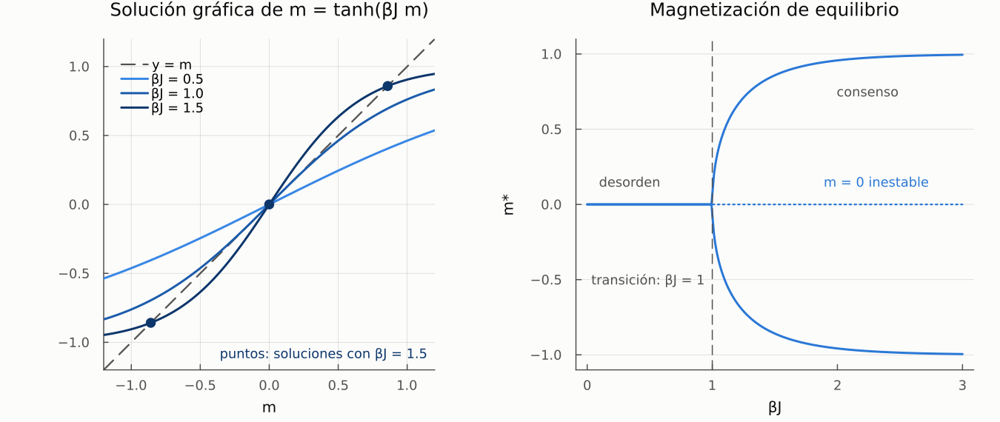
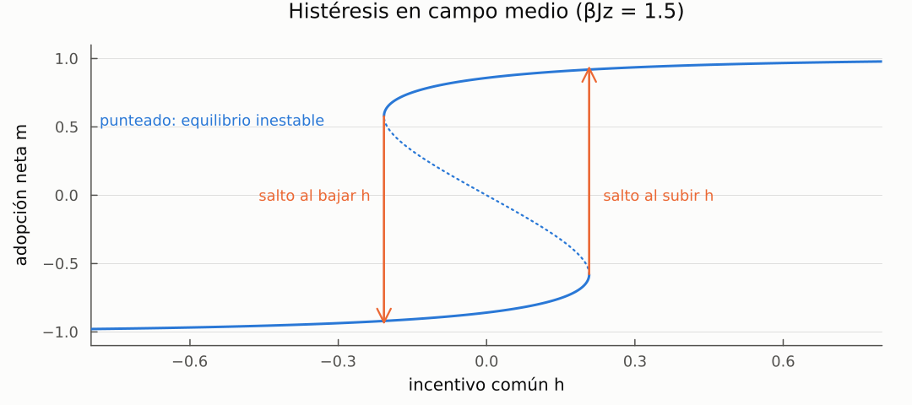
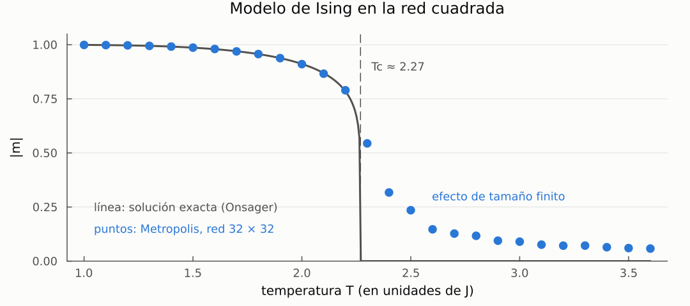
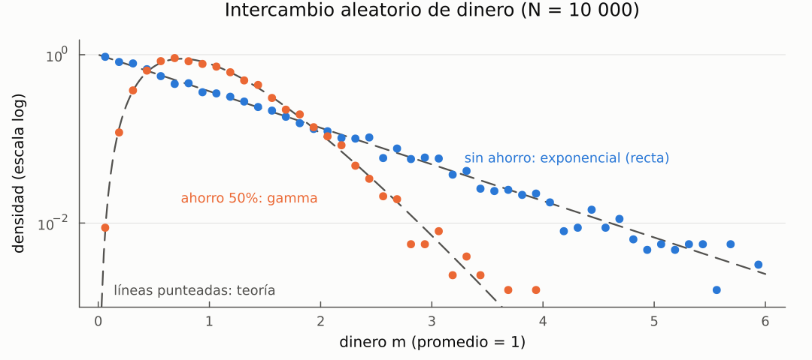

# Repaso: física estadística

> Cada concepto tiene una clave (por ejemplo **[F.I3](#fi3)**) y dice en qué sesiones
> se usa. El índice [README.md](README.md) indica qué repasar antes de cada
> sesión. Supone [probabilidad](probabilidad.md) y [cálculo](calculo.md)
> hasta el nivel correspondiente. Los fragmentos de Julia corren en el
> entorno del curso (`julia --project=Code`).
>
> - **Básico**: lo necesario para la ruta básica.
> - **Intermedio**: lo necesario para leer las notas formales.
> - **Avanzado**: lo necesario para la ruta avanzada.
>
> Esta nota no supone ningún curso previo de física.

---

## Nivel básico

<a id="fb1"></a>

### F.B1 De lo micro a lo macro
*Sesiones 1, 8, 13.*

La física estadística explica propiedades **macroscópicas** (presión,
temperatura, magnetización) a partir de reglas **microscópicas** para
muchísimas partículas, sin seguir a cada una. Funciona porque, con muchos
componentes, los promedios fluctúan poco (ley de los grandes números, [P.B5](probabilidad.md#pb5)):
nadie predice una molécula, pero la presión de un gas sí se predice.

- **Microestado**: la descripción completa del sistema (la posición de cada
  molécula; el dinero de cada agente).
- **Macroestado**: lo que medimos en agregado (la presión; la distribución
  del dinero, el índice de Gini).

Muchos microestados distintos producen el mismo macroestado. La econofísica
usa el mismo razonamiento con agentes en lugar de partículas:

| Física | Economía y sociedad |
|---|---|
| Partícula, espín | Agente, hogar, empresa, votante |
| Energía | Dinero (si se conserva) o menos la utilidad |
| Interacción entre vecinos | Imitación, comercio, contagio |
| Campo externo $h$ | Incentivo común: precio, política, publicidad |
| Temperatura $T$ | Ruido, heterogeneidad no observada |
| $\beta = 1/T$ | Intensidad de elección, "racionalidad" |
| Magnetización $m$ | Fracción neta que adopta una opción |

**Cuidado con la analogía.** "Equilibrio" en física estadística significa
una **distribución estacionaria** en la que los agentes siguen cambiando de
estado; no es un equilibrio walrasiano ni de Nash. Y muchas reglas
económicas no conservan nada ni cumplen balance detallado ([E.A3](procesos_estocasticos.md#ea3)): son
sistemas **fuera de equilibrio**, y las fórmulas de equilibrio no siempre
aplican.

<a id="fb2"></a>

### F.B2 Entropía como conteo
*Sesiones 8, 9.*

Para un macroestado, sea $W$ el número de microestados compatibles con él.
La **entropía** (en unidades donde la constante de Boltzmann vale 1) es

$$
S = \ln W.
$$

**Ejemplo.** Lanzamos 100 monedas. El macroestado "50 águilas" tiene
$W = \binom{100}{50} \approx 10^{29}$ microestados; "100 águilas", sólo uno.
Si todos los microestados son igualmente probables, casi siempre veremos
cerca de 50: **el macroestado más probable es el de mayor entropía**.

Ésta es la idea detrás de la sesión 8: si el dinero total se conserva y los
intercambios lo reparten al azar, la distribución que se observa es la que
tiene más formas de realizarse, y resulta ser la **exponencial** ([C.A1](calculo.md#ca1)).

<a id="fb3"></a>

### F.B3 Temperatura: ruido contra orden
*Sesiones 8, 13, 15.*

En el curso, la temperatura $T$ (o su inverso $\beta = 1/T$) mide cuánto
**ruido** hay en las decisiones frente a la tendencia a minimizar energía
(o maximizar utilidad):

- $T \to 0$ ($\beta \to \infty$): cada agente elige siempre lo mejor.
  Orden total.
- $T \to \infty$ ($\beta \to 0$): cada agente elige al azar. Desorden
  total.
- En medio, compiten el orden (energía) y el desorden (entropía). De esa
  competencia salen las transiciones de fase.

En el intercambio de dinero (sesión 8), la "temperatura" es otra cosa:
$T = \langle m\rangle$, el dinero promedio por agente. Ambas comparten el
papel matemático de escala en $e^{-E/T}$.

<a id="fb4"></a>

### F.B4 Transiciones de fase
*Sesiones 9, 10, 11, 13, 15, 16, 19.*

Una **transición de fase** es un cambio **cualitativo y abrupto** en el
comportamiento colectivo cuando un parámetro cruza un valor crítico.

- **Parámetro de control**: lo que movemos (temperatura, intensidad de
  imitación, densidad de enlaces, tasa de intercambio).
- **Parámetro de orden**: lo que medimos y que vale 0 en una fase y distinto
  de 0 en la otra (magnetización, tamaño del componente gigante, fracción de
  riqueza del más rico).

| Sesión | Sistema | Control | Orden |
|---|---|---|---|
| 9 | Bouchaud-Mézard | Intensidad de intercambio | Fracción de la riqueza en pocos agentes (condensación) |
| 10, 11 | Redes aleatorias | Grado promedio $\langle k\rangle$ o nodos eliminados $f$ | Tamaño del componente gigante |
| 13 | Ising, Brock-Durlauf | $\beta J$ | Magnetización, adopción neta |
| 15 | Votante, Kirman | Ruido, red | Consenso o bimodalidad |
| 19 | Juego de la minoría | $\alpha = 2^M/N$ | Volatilidad $\sigma^2/N$, predictibilidad |

En una simulación finita la transición se ve **suavizada**: el cambio
abrupto aparece sólo cuando el número de agentes crece.

---

## Nivel intermedio

<a id="fi1"></a>

### F.I1 Distribución de Boltzmann y función de partición
*Sesiones 8, 13.*

Un sistema en equilibrio a temperatura $T = 1/\beta$ ocupa el estado $i$,
con energía $E_i$, con probabilidad

$$
p_i = \frac{e^{-\beta E_i}}{Z},
\qquad
Z = \sum_i e^{-\beta E_i}.
$$

$Z$ es la **función de partición**: normaliza las probabilidades y, además,
contiene toda la termodinámica. Por ejemplo, la energía promedio es

$$
\langle E\rangle = \sum_i E_i\thinspace p_i = -\frac{\partial \ln Z}{\partial \beta}.
$$

La distribución de Boltzmann es la de **máxima entropía** con energía
promedio fija; la derivación está en [C.A1](calculo.md#ca1).

**Ejemplo: un espín en un campo.** Dos estados $s = \pm 1$ con energía
$E = -hs$:

$$
\mathbb{P}(s = +1) = \frac{e^{\beta h}}{e^{\beta h} + e^{-\beta h}} = \sigma(2\beta h),
\qquad
\langle s\rangle = \tanh(\beta h).
$$

La logística y la tangente hiperbólica ([C.B4](calculo.md#cb4)) son la física de un sistema
de dos estados.

<a id="fi2"></a>

### F.I2 Logit = Boltzmann
*Sesión 13.*

**Modelo de elección discreta** (McFadden). Un agente elige la opción $i$
entre varias con utilidad

$$
U_i = u_i + \varepsilon_i,
$$

donde $u_i$ es la parte observable y $\varepsilon_i$ un choque aleatorio.
Si los $\varepsilon_i$ son i.i.d. con distribución de Gumbel de escala
$1/\beta$, la probabilidad de que $i$ sea la mejor es

$$
\mathbb{P}(i) = \frac{e^{\beta u_i}}{\sum_j e^{\beta u_j}}.
$$

Es **exactamente** la distribución de Boltzmann con energía $E_i = -u_i$.
El modelo logit, que usan los economistas para estimar demanda, es física
estadística: $\beta$ es la intensidad de elección y $1/\beta$ la
"temperatura" de los choques idiosincráticos. Brock y Durlauf (2001)
explotan esta equivalencia para añadir interacciones sociales: el resultado
es un modelo de Ising.

<a id="fi3"></a>

### F.I3 Modelo de Ising
*Sesiones 13, 15, 16.*

$N$ espines $s_i \in \lbrace-1, +1\rbrace$ en los nodos de una red, con energía

$$
H(s) = -J\sum_{\langle i,j\rangle} s_i s_j - h\sum_i s_i,
$$

donde $\langle i,j\rangle$ recorre los pares de vecinos.

- $J > 0$: a cada espín le conviene alinearse con sus vecinos
  (**conformidad**, imitación).
- $h$: campo externo común, que favorece $+1$ si $h > 0$.
- **Magnetización**: $m = \frac1N\sum_i s_i \in [-1, 1]$. En lectura
  social: $s_i = +1$ adopta, $-1$ no adopta; $m$ es la adopción neta.

Con $h = 0$ y en dos dimensiones o más:

- $T$ alta: los espines fluctúan al azar, $m \approx 0$.
- $T$ por debajo de una **temperatura crítica** $T_c$: aparece un consenso
  espontáneo, $|m| > 0$, **sin que nada externo lo favorezca**. El signo lo
  decide el azar inicial.

En la red cuadrada, $T_c = 2J/\ln(1+\sqrt2) \approx 2.269\thinspace J$ (Onsager, 1944).
En una dimensión no hay transición a $T > 0$.

<a id="fi4"></a>

### F.I4 Aproximación de campo medio
*Sesiones 14, 15.*

Cada espín siente el **campo local** $h_i = J\sum_{j \in \text{vecinos}} s_j + h$.
La aproximación de campo medio reemplaza a los vecinos por su promedio:
con $z$ vecinos, $h_i \approx Jzm + h$. Usando el resultado de un espín
([F.I1](#fi1)),

$$
m = \tanh\big(\beta(Jzm + h)\big).
$$

Es una ecuación de punto fijo que se resuelve gráficamente ([C.I5](calculo.md#ci5)):

- Con $h = 0$, hay solución $m \ne 0$ si y sólo si $\beta Jz > 1$:
  $T_c^{\text{cm}} = Jz$. (En la red cuadrada, $z = 4$ da $T_c = 4J$,
  mayor que el exacto 2.269: el campo medio **sobreestima** el orden
  porque ignora las fluctuaciones.)
- Brock-Durlauf obtienen la misma ecuación con $h$ = utilidad privada de
  adoptar y $J$ = utilidad social de coincidir con los demás.



*Izquierda: las soluciones son los cruces de y = m con tanh(βJ m). Derecha: por encima de βJ = 1 aparecen dos estados de consenso y el desorden se vuelve inestable.*

**Histéresis.** Con $\beta Jz > 1$ y $h$ variando, hay un rango de $h$ con
tres soluciones. El sistema se queda en la rama en la que está hasta que
ésta desaparece, y entonces **salta**. Si $h$ sube y luego baja, el salto
de ida y el de regreso ocurren en valores distintos: el estado depende de
la historia. En lectura económica: un cambio gradual de incentivos puede
producir un cambio de comportamiento repentino, y revertir el incentivo no
basta para revertirlo.



*Con βJz = 1.5, al subir el incentivo h la adopción salta hacia arriba en h ≈ 0.21; al bajarlo, salta hacia abajo en h ≈ −0.21. Entre ambos valores, el estado depende de la historia.*

<a id="fi5"></a>

### F.I5 Simulación de Monte Carlo: algoritmo de Metropolis
*Sesión 13.*

Para muestrear configuraciones con probabilidad $\propto e^{-\beta H}$ sin
calcular $Z$ (que tiene $2^N$ términos):

1. Elegir un espín $i$ al azar.
2. Calcular el cambio de energía $\Delta E$ si se voltea.
3. Voltearlo con probabilidad $\min(1, e^{-\beta\Delta E})$: siempre si
   baja la energía; a veces si la sube.
4. Repetir. $N$ intentos forman un **barrido**.

La regla cumple **balance detallado** ([E.A3](procesos_estocasticos.md#ea3)) respecto a la distribución de
Boltzmann, así que la cadena de Markov converge a ella. Hay que descartar
los primeros barridos (**termalización**) antes de medir.

Para el Ising, voltear $s_i$ cambia la energía en
$\Delta E = 2s_i\big(J\sum_{j} s_j + h\big)$.



*La simulación sigue la solución exacta lejos de Tc. Cerca y por encima de Tc, la red finita conserva una magnetización residual que desaparecería en una red infinita.*

```julia
using Random, Statistics
function ising(L, T; barridos = 2_000, rng = Xoshiro(1))
    s = ones(Int, L, L); β = 1 / T; ms = Float64[]
    for b in 1:barridos
        for _ in 1:L^2
            i, j = rand(rng, 1:L), rand(rng, 1:L)
            vecinos = s[mod1(i+1, L), j] + s[mod1(i-1, L), j] +
                      s[i, mod1(j+1, L)] + s[i, mod1(j-1, L)]
            ΔE = 2 * s[i, j] * vecinos                     # J = 1, h = 0
            if ΔE <= 0 || rand(rng) < exp(-β * ΔE)
                s[i, j] = -s[i, j]
            end
        end
        b > barridos ÷ 2 && push!(ms, abs(mean(s)))       # mide en la 2.ª mitad
    end
    mean(ms)
end
[ising(32, T) for T in (1.5, 2.0, 2.5, 3.5)]   # |m| alto abajo de T_c ≈ 2.27, pequeño arriba
```

<a id="fi6"></a>

### F.I6 Modelos cinéticos de intercambio
*Sesiones 8, 9.*

Analogía con un gas: los agentes son moléculas y cada transacción es un
choque que redistribuye dinero entre dos de ellos, **conservando** el total
(como un choque conserva la energía).

- **Intercambio aleatorio** (Dragulescu-Yakovenko): en cada encuentro, los
  dos agentes juntan su dinero y lo reparten con una fracción uniforme. La
  distribución estacionaria es **exponencial**,
  $p(m) = e^{-m/T}/T$ con $T = \langle m\rangle$: la de Boltzmann.
- **Con ahorro** $\lambda$ (Chakraborti-Chakrabarti): cada agente guarda
  una fracción $\lambda$ y sólo intercambia el resto. La distribución se
  aproxima por una **gamma** con forma $n = 1 + 3\lambda/(1-\lambda)$: hay
  menos pobres extremos y la desigualdad baja.
- **Ahorro heterogéneo** (cada agente con su $\lambda_i$): aparece una cola
  de **Pareto** con exponente cercano a 1.



*Distribución estacionaria del dinero. Sin ahorro es exponencial, una recta en escala semilog; con ahorro del 50% se aproxima por una gamma: hay muchos menos agentes con muy poco dinero.*

---

## Nivel avanzado

<a id="fa1"></a>

### F.A1 Energía libre y teoría de Landau
*Sesión 14.*

La **energía libre** es

$$
F = -T\ln Z = \langle E\rangle - TS.
$$

En equilibrio, el sistema minimiza $F$: a $T$ baja domina la energía
(orden); a $T$ alta domina la entropía (desorden).

**Teoría de Landau.** Cerca de $T_c$, el parámetro de orden $m$ es pequeño y
la energía libre por espín se desarrolla en potencias (con simetría
$m \to -m$ si $h = 0$):

$$
f(m) = f_0 + a\thinspace(T - T_c)\thinspace m^2 + b\thinspace m^4, \qquad a, b > 0.
$$

- $T > T_c$: el mínimo está en $m = 0$.
- $T < T_c$: el coeficiente de $m^2$ es negativo y aparecen dos mínimos en
  $m = \pm\sqrt{a(T_c - T)/2b}$.

Así, $m \propto (T_c - T)^{1/2}$: el mismo resultado que da el desarrollo
de Taylor de $\tanh$ en el campo medio ([C.I1](calculo.md#ci1)).

<a id="fa2"></a>

### F.A2 Exponentes críticos y universalidad
*Sesiones 2, 14, 19.*

Cerca del punto crítico, las cantidades se comportan como **leyes de
potencias** en $|T - T_c|$:

$$
m \sim (T_c - T)^{b},
\qquad
\chi = \frac{\partial m}{\partial h} \sim |T - T_c|^{-g},
\qquad
m \sim h^{1/d} \text{ en } T = T_c.
$$

(Se suelen llamar $\beta, \gamma, \delta$; aquí usamos $b, g, d$ para no
confundirlos con otras letras del curso.)

| | $b$ | $g$ | $d$ |
|---|---|---|---|
| Campo medio | 1/2 | 1 | 3 |
| Ising en 2D (exacto) | 1/8 | 7/4 | 15 |

**Universalidad.** Sistemas microscópicamente muy distintos (un imán, un
líquido en su punto crítico, una aleación) tienen **los mismos exponentes**
si comparten dimensión y simetría: forman una *clase de universalidad*.
Los detalles microscópicos no importan cerca del punto crítico, porque las
correlaciones se extienden a todas las escalas (la longitud de correlación
diverge).

Por eso la universalidad de los hechos estilizados ([sesión 2](../s02_volatilidad.md)) sugiere a los
físicos que los mercados podrían estar cerca de un punto crítico. Es una
hipótesis atractiva, pero no demostrada: hay otros mecanismos que generan
leyes de potencias (Kesten, [E.I6](procesos_estocasticos.md#ei6)).

<a id="fa3"></a>

### F.A3 Campo aleatorio, avalanchas y crisis
*Sesión 14.*

**Modelo de Ising con campo aleatorio.** Cada agente tiene su propio
incentivo privado $h_i$, tomado de una distribución con dispersión $R$, más
un campo común $h$ que varía lentamente:

$$
H = -J\sum_{\langle i,j\rangle}s_is_j - \sum_i (h + h_i)s_i.
$$

A temperatura cero, cuando $h$ sube, un agente cambia de opinión, eso
empuja a sus vecinos y puede desencadenar una **avalancha**.

- Con mucha heterogeneidad ($R$ grande), las avalanchas son pequeñas y la
  respuesta agregada es suave.
- Con poca ($R$ pequeño), hay un salto macroscópico: una **crisis**.
- En un $R_c$ crítico, el tamaño de las avalanchas sigue una ley de
  potencias.

Bouchaud (2013) lo usa para explicar cambios abruptos de opinión,
pánicos bancarios y caídas del consumo.

<a id="fa4"></a>

### F.A4 Vidrios de espín
*Sesiones 14, 19.*

Si los acoplamientos $J_{ij}$ son aleatorios y de **ambos signos** (unos
agentes quieren coincidir y otros diferir), no es posible satisfacer todas
las interacciones a la vez: hay **frustración**. El resultado es un paisaje
de energía con muchísimos mínimos locales, y el sistema puede quedar
atrapado en cualquiera de ellos.

Las técnicas desarrolladas para estos sistemas (modelo de
Sherrington-Kirkpatrick, método de réplicas) resolvieron analíticamente el
juego de la minoría y se aplican a problemas de optimización y de
coordinación con muchos equilibrios (Bouchaud, Marsili & Nadal, 2023).

<a id="fa5"></a>

### F.A5 Percolación
*Sesiones 10, 11, 12.*

En una red, cada enlace (o nodo) está presente con probabilidad $p$. La
pregunta: ¿existe un **componente gigante** que contenga una fracción
finita de todos los nodos?

- Hay un umbral $p_c$: por debajo, sólo grupos pequeños; por encima, un
  componente gigante. Es una transición de fase con parámetro de orden
  igual a la fracción de nodos en el componente gigante.
- En una red de Erdős-Rényi, el componente gigante aparece cuando el grado
  promedio cruza $\langle k\rangle = 1$.
- **Robustez**: quitar nodos al azar es percolación con $p$ = fracción que
  sobrevive. Las redes libres de escala (Barabási-Albert) casi no tienen
  umbral ante fallas aleatorias, pero se fragmentan rápido si se atacan sus
  nodos de mayor grado.
- Las cascadas de Watts (sesión 12) son una percolación sobre los nodos
  "vulnerables".

---

## Autodiagnóstico

<details>
<summary><b>1 (B).</b> Repartimos 4 monedas entre 2 agentes, A y B. ¿Cuántos microestados tiene el macroestado "A tiene 2 monedas" si las monedas son distinguibles? ¿Y "A tiene 4"?</summary>

$\binom{4}{2} = 6$ y $\binom{4}{4} = 1$. El reparto equitativo es más
probable porque tiene más microestados.
</details>

<details>
<summary><b>2 (B).</b> En un modelo de opinión, ¿qué esperas ver si el ruido es muy grande? ¿Y si es casi nulo?</summary>

Ruido grande: opiniones mezcladas, $m \approx 0$. Ruido casi nulo: consenso
(si la interacción favorece coincidir), $|m|$ cercano a 1.
</details>

<details>
<summary><b>3 (B).</b> En la sesión 11, ¿cuál es el parámetro de control y cuál el de orden de la transición del componente gigante?</summary>

Control: el grado promedio $\langle k\rangle$ (o la probabilidad de enlace).
Orden: la fracción de nodos en el componente más grande.
</details>

<details>
<summary><b>4 (B).</b> En un modelo de 1000 agentes que intercambian dinero, ¿qué es un microestado y qué es un macroestado? Da un ejemplo de cada uno.</summary>

Un microestado es la lista completa de cuánto dinero tiene cada uno de los
1000 agentes. Un macroestado es una descripción agregada, como el
histograma del dinero o el índice de Gini. Muchos microestados distintos
dan el mismo macroestado.
</details>

<details>
<summary><b>5 (B).</b> En tu simulación, el parámetro de orden cambia de forma gradual, no abrupta. ¿Quiere decir que no hay transición de fase?</summary>

No necesariamente. Con un número finito de agentes la transición se ve
suavizada; el cambio abrupto aparece en el límite de muchos agentes.
Repetir la simulación con más agentes y ver si el cambio se vuelve más
brusco es la forma de comprobarlo.
</details>

<details>
<summary><b>6 (I).</b> Un sistema tiene tres estados con energías 0, 1 y 2. Con β = ln 2, ¿cuál es la probabilidad de cada uno?</summary>

$e^{-\beta E} = 1, 1/2, 1/4$; $Z = 7/4$; probabilidades $4/7, 2/7, 1/7$.
</details>

<details>
<summary><b>7 (I).</b> En el logit binario, la opción A tiene utilidad 1 y B utilidad 0. ¿Con qué probabilidad se elige A si β = 0? ¿Y si β → ∞?</summary>

$\mathbb{P}(A) = \sigma(\beta \cdot 1)$: con $\beta = 0$, $1/2$; con
$\beta \to \infty$, 1.
</details>

<details>
<summary><b>8 (I).</b> En campo medio con <i>z</i> = 6 vecinos y <i>J</i> = 1, ¿cuál es la temperatura crítica? ¿Hay consenso espontáneo en <i>T</i> = 5?</summary>

$T_c = Jz = 6$. Como $5 < 6$, sí: $\beta Jz = 6/5 > 1$ y hay soluciones
$m \ne 0$.
</details>

<details>
<summary><b>9 (I).</b> En Metropolis con β = 1, un volteo sube la energía en 4. ¿Con qué probabilidad se acepta? ¿Y si la baja en 4?</summary>

$e^{-4} \approx 0.018$; si la baja, se acepta siempre.
</details>

<details>
<summary><b>10 (A).</b> Usa el desarrollo tanh <i>x</i> ≈ <i>x</i> − <i>x</i>³/3 para encontrar cómo crece <i>m</i> justo debajo de <i>T</i><sub>c</sub> en campo medio.</summary>

Con $K = \beta Jz$: $m \approx Km - K^3m^3/3$, así que
$m^2 \approx 3(K - 1)/K^3$ y $m \propto (K - 1)^{1/2} \propto (T_c - T)^{1/2}$:
exponente $b = 1/2$.
</details>

---

## Para profundizar

- Sen & Chakrabarti (2014), caps. 2–3: física estadística para
  sociofísica, Ising y campo medio.
- Requião da Cunha (2021), cap. 6: modelos de Ising en econofísica.
- Yakovenko & Rosser (2009): mecánica estadística del dinero y del ingreso.
- Castellano, Fortunato & Loreto (2009): física estadística de dinámicas
  sociales.
- Bouchaud, J.-P. (2013). Crises and collective socio-economic phenomena:
  simple models and challenges. *Journal of Statistical Physics*, 151,
  567–606. https://doi.org/10.1007/s10955-012-0687-3
- Bouchaud, Marsili & Nadal (2023): vidrios de espín en ciencias sociales.
