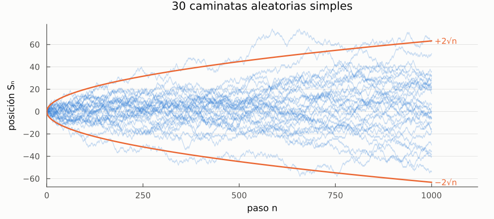
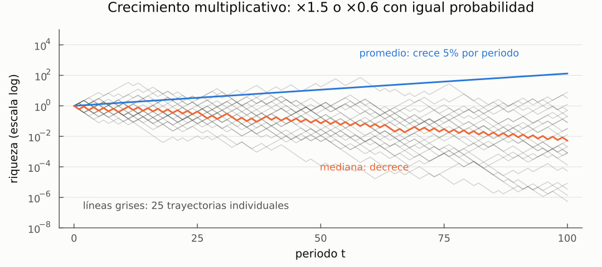

# Repaso: procesos estocásticos

> Cada concepto tiene una clave (por ejemplo **[E.I3](#ei3)**) y dice en qué sesiones
> se usa. El índice [README.md](README.md) indica qué repasar antes de cada
> sesión. Supone el repaso de [probabilidad](probabilidad.md) hasta el nivel
> correspondiente. Los fragmentos de Julia corren en el entorno del curso
> (`julia --project=Code`).
>
> - **Básico**: lo necesario para la ruta básica.
> - **Intermedio**: lo necesario para leer las notas formales.
> - **Avanzado**: lo necesario para la ruta avanzada.

---

## Nivel básico

<a id="eb1"></a>

### E.B1 Qué es un proceso estocástico
*Sesiones 1, 4.*

Un **proceso estocástico** $\lbrace X_t\rbrace$ es una colección de variables aleatorias
indexadas por el tiempo: el precio de cada día, la riqueza de un agente en
cada paso de la simulación, la fracción de agentes optimistas.

- **Tiempo discreto** ($t = 0, 1, 2, \dots$) o **continuo** ($t \ge 0$).
- Una **trayectoria** (o realización) es una de las historias posibles. Los
  datos de un mercado son **una sola** trayectoria; en una simulación podemos
  generar tantas como queramos.
- **Ruido blanco**: una secuencia $\varepsilon_1, \varepsilon_2, \dots$
  i.i.d. con media 0 y varianza $\sigma^2$. Es el ladrillo con el que se
  construyen casi todos los procesos del curso.

**Semillas.** Una simulación usa números pseudoaleatorios. Fijar la semilla
hace que el resultado sea reproducible; cambiarla da otra trayectoria.

```julia
using Random
rng = Xoshiro(42)          # misma semilla → mismos números
ε = randn(rng, 1_000)      # ruido blanco gaussiano
```

<a id="eb2"></a>

### E.B2 Caminata aleatoria
*Sesiones 1, 4, 15.*

$$
S_n = S_0 + \sum_{i=1}^n \xi_i,
\qquad \xi_i \text{ i.i.d.}
$$

En la **caminata simple**, $\xi_i = +1$ o $-1$ con probabilidad $1/2$, así
que cada paso tiene media 0 y varianza 1. Como los pasos son independientes,
por [P.B2](probabilidad.md#pb2):

$$
\mathbb{E}[S_n] = S_0, \qquad \mathrm{Var}[S_n] = n.
$$

- La distancia típica al origen crece como $\sqrt{n}$, no como $n$. Es la
  firma de la **difusión**.
- Por el TLC, $S_n$ es aproximadamente normal para $n$ grande.
- El logaritmo del precio como caminata aleatoria ($\ln P_t = \ln P_0 + \sum r_i$)
  es el modelo de Bachelier (1900), el punto de partida de la econofísica.



*La dispersión de las trayectorias crece como √n: casi todas quedan dentro de ±2√n.*

```julia
using Random, Statistics
rng = Xoshiro(1)
caminatas = [cumsum(rand(rng, (-1, 1), 1_000)) for _ in 1:5_000]
var([c[end] for c in caminatas])   # ≈ 1000
```

<a id="eb3"></a>

### E.B3 Promediar simulaciones
*Sesiones 4 en adelante.*

Una sola simulación de un modelo de agentes es una trayectoria; para medir
algo hay que **promediar**. Hay dos formas:

- **Promedio de ensamble**: correr $M$ simulaciones independientes y
  promediar el valor en el tiempo $t$. Error estándar $\sigma/\sqrt{M}$
  ([P.B5](probabilidad.md#pb5)).
- **Promedio temporal**: correr una sola simulación larga y promediar a lo
  largo del tiempo, después de descartar el **transitorio** inicial.

Si el proceso es estacionario y **ergódico**, ambos promedios coinciden.
No siempre lo son: en el crecimiento multiplicativo ([E.I6](#ei6)) el promedio de
ensamble y la trayectoria típica se comportan muy distinto.

---

## Nivel intermedio

<a id="ei1"></a>

### E.I1 Estacionariedad y autocorrelación
*Sesiones 1, 2, 5, 20.*

Un proceso es **débilmente estacionario** si su media y su varianza no
dependen de $t$ y la covarianza entre $X_t$ y $X_{t+\tau}$ depende sólo de
$\tau$. Su **función de autocorrelación** es
$\rho(\tau) = \mathrm{corr}(X_t, X_{t+\tau})$.

**Ejemplo: AR(1).** $X_t = \phi X_{t-1} + \varepsilon_t$ con $|\phi| < 1$ y
$\varepsilon_t$ ruido blanco de varianza $\sigma^2$.

- Varianza estacionaria: $\mathrm{Var}[X] = \phi^2\mathrm{Var}[X] + \sigma^2 \Rightarrow \mathrm{Var}[X] = \sigma^2/(1-\phi^2)$.
- Autocorrelación: $\rho(\tau) = \phi^\tau = e^{-\tau/\tau_0}$ con
  $\tau_0 = -1/\ln\phi$. **Decaimiento exponencial**: memoria corta, con una
  escala de tiempo característica $\tau_0$.
- Si $\phi = 1$, es una caminata aleatoria: no es estacionaria.

Contraste: la autocorrelación de $|r_t|$ en los datos decae como ley de
potencias $\tau^{-\beta}$, sin escala característica (memoria larga). Un
AR(1) no la reproduce.

```julia
using Random, StatsBase
rng = Xoshiro(1); ϕ = 0.8
x = zeros(10_000)
for t in 2:length(x); x[t] = ϕ * x[t-1] + randn(rng); end
autocor(x, 1:5)            # ≈ 0.8, 0.64, 0.51, ...
```

<a id="ei2"></a>

### E.I2 Martingalas
*Sesiones 1, 4, 15.*

$\lbrace X_t\rbrace$ es una **martingala** respecto a la información $\mathcal F_t$ si

$$
\mathbb{E}[X_{t+1} \mid \mathcal F_t] = X_t.
$$

"La mejor predicción del valor de mañana es el valor de hoy." Es la
formalización de un **juego justo** y de la hipótesis de mercado eficiente.

- La caminata aleatoria con $\mathbb{E}[\xi] = 0$ es una martingala.
- Los incrementos $X_{t+1} - X_t$ de una martingala son **incorrelados**
  entre sí (demostración en las [notas de la sesión 1](../s01_retornos.md)), pero no
  necesariamente independientes: su varianza puede depender del pasado.

<a id="ei3"></a>

### E.I3 Cadenas de Markov
*Sesiones 4, 15.*

Un proceso con estados discretos es una **cadena de Markov** si el futuro
depende del pasado sólo a través del presente:

$$
\mathbb{P}(X_{t+1} = j \mid X_t = i, X_{t-1}, \dots) = \mathbb{P}(X_{t+1} = j \mid X_t = i) = P_{ij}.
$$

- **Matriz de transición** $P$: cada fila suma 1.
- Si $\pi_t$ es el vector (fila) de probabilidades en el tiempo $t$,
  entonces $\pi_{t+1} = \pi_t P$ y $\pi_t = \pi_0 P^t$.
- **Distribución estacionaria**: $\pi = \pi P$. Es un eigenvector izquierdo
  de $P$ con eigenvalor 1. Si la cadena es irreducible (se puede llegar de
  cualquier estado a cualquier otro) y aperiódica, $\pi_t \to \pi$ desde
  cualquier condición inicial.

**Ejemplo: dos estados** (calma, turbulencia):

$$
P = \begin{pmatrix} 1-p & p \cr q & 1-q \end{pmatrix},
\qquad
\pi = \left(\frac{q}{p+q},\  \frac{p}{p+q}\right).
$$

El tiempo medio que se permanece en calma es $1/p$ días.

El modelo de hormigas de Kirman (sesión 15) es una cadena de Markov sobre el
número de agentes con cada opinión.

```julia
using LinearAlgebra
p, q = 0.05, 0.20
P = [1-p p; q 1-q]
vals, vecs = eigen(P')                  # eigenvectores izquierdos de P
π_est = real(vecs[:, argmax(real(vals))]); π_est ./= sum(π_est)
π_est                                   # ≈ [0.8, 0.2]
```

<a id="ei4"></a>

### E.I4 Modelos de volatilidad: ARCH y GARCH
*Sesiones 5, 20.*

Idea: el retorno es ruido con una volatilidad que **cambia en el tiempo y
depende del pasado**,

$$
r_t = \sigma_t\thinspace\varepsilon_t,
\qquad \varepsilon_t \text{ i.i.d. } \mathcal{N}(0,1).
$$

**GARCH(1,1)** (Bollerslev, 1986):

$$
\sigma_t^2 = \omega + a\thinspace r_{t-1}^2 + b\thinspace\sigma_{t-1}^2,
\qquad \omega > 0,\  a, b \ge 0.
$$

(En la literatura se usan $\alpha$ y $\beta$ en lugar de $a$ y $b$; aquí
cambiamos de letra para no confundirlos con los exponentes de cola.)

- Un día con $|r_{t-1}|$ grande sube $\sigma_t$: **agrupamiento de
  volatilidad**.
- Es estacionario si $a + b < 1$, con varianza incondicional
  $\omega/(1 - a - b)$. Con datos diarios se estima típicamente
  $a + b \approx 0.98$: volatilidad muy persistente.
- $\mathbb{E}[r_t \mid \mathcal F_{t-1}] = 0$: los retornos son una
  diferencia de martingala, sin autocorrelación lineal.
- Genera colas pesadas aunque $\varepsilon_t$ sea normal.
- La autocorrelación de $r_t^2$ decae **exponencialmente** como $(a+b)^\tau$,
  más rápido que la ley de potencias observada.

<a id="ei5"></a>

### E.I5 Ecuación de Langevin y Euler-Maruyama
*Sesiones 5, 9.*

Una **ecuación diferencial estocástica** escribe el cambio de $X$ como
"tendencia + ruido":

$$
dX_t = A(X_t)\thinspace dt + B(X_t)\thinspace dW_t,
$$

donde $A$ es la **deriva**, $B$ la intensidad del ruido y $dW_t$ un
incremento de movimiento browniano: normal con media 0 y varianza $dt$.

**Simulación (Euler-Maruyama).** Con paso $\Delta t$ y $Z_k$ i.i.d.
$\mathcal{N}(0,1)$:

$$
X_{k+1} = X_k + A(X_k)\thinspace\Delta t + B(X_k)\thinspace\sqrt{\Delta t}\thinspace Z_k.
$$

El ruido escala con $\sqrt{\Delta t}$, no con $\Delta t$: es la difusión de
[E.B2](#eb2).

**Dos ejemplos del curso:**

| Proceso | Ecuación | Comportamiento |
|---|---|---|
| Ornstein-Uhlenbeck | $dX = -\theta X\thinspace dt + \sigma\thinspace dW$ | Regresa a 0; estacionario con varianza $\sigma^2/2\theta$ |
| Movimiento browniano geométrico (GBM) | $dP = \mu P\thinspace dt + \sigma P\thinspace dW$ | Precio siempre positivo; retornos logarítmicos normales e i.i.d. |

```julia
using Random
function gbm(P0, μ, σ, T, Δt; rng = Xoshiro(1))
    n = round(Int, T / Δt); P = zeros(n + 1); P[1] = P0
    for k in 1:n
        P[k+1] = P[k] + μ * P[k] * Δt + σ * P[k] * sqrt(Δt) * randn(rng)
    end
    P
end
gbm(100.0, 0.05, 0.2, 1.0, 1/252)   # un año de precios diarios
```

<a id="ei6"></a>

### E.I6 Crecimiento multiplicativo: Gibrat y Kesten
*Sesiones 5, 6, 8, 9.*

**Gibrat.** El tamaño de una empresa crece por un factor aleatorio:
$x_{t+1} = a_t\thinspace x_t$ con $a_t > 0$ i.i.d. Entonces
$\ln x_t = \ln x_0 + \sum_{s<t} \ln a_s$ es una caminata aleatoria y $x_t$ es
aproximadamente **lognormal** ([P.I6](probabilidad.md#pi6)). La varianza de $\ln x_t$ crece sin
límite: no hay distribución estacionaria.

**Promedio vs. trayectoria típica.** Con $a = 1.5$ o $0.6$ con probabilidad
$1/2$:

- $\mathbb{E}[a] = 1.05$: el **promedio de ensamble** crece 5% por paso.
- $\mathbb{E}[\ln a] = \tfrac12(\ln 1.5 + \ln 0.6) \approx -0.053$: la
  **trayectoria típica** decrece.

El promedio lo sostienen unas pocas trayectorias afortunadas. Es un ejemplo
de proceso **no ergódico** ([E.B3](#eb3)) y una aplicación de Jensen ([P.A5](probabilidad.md#pa5)).



*El promedio de ensamble crece, pero la mediana, que es la trayectoria típica, decrece. El promedio lo sostienen unas pocas trayectorias con mucha suerte.*

**Kesten.** Se añade un término aditivo (o una barrera inferior):

$$
x_{t+1} = a_t\thinspace x_t + b_t,
\qquad \mathbb{E}[\ln a_t] < 0.
$$

La parte multiplicativa contrae en promedio y $b_t$ impide llegar a cero. El
resultado es una distribución **estacionaria con cola de ley de potencias**,
$\bar F(x) \sim x^{-\alpha}$. Es un mecanismo genérico para leyes de
potencias en tamaños de empresas, ciudades y riqueza (sesiones 6 y 9).

---

## Nivel avanzado

<a id="ea1"></a>

### E.A1 Movimiento browniano
*Sesiones 4, 5.*

El **movimiento browniano** (proceso de Wiener) $W_t$ es el límite continuo
de la caminata aleatoria. Se caracteriza por:

1. $W_0 = 0$ y trayectorias continuas.
2. Incrementos independientes: $W_{t} - W_{s}$ es independiente del pasado
   hasta $s$.
3. $W_t - W_s \sim \mathcal{N}(0,\thinspace t - s)$.

Propiedades contraintuitivas: sus trayectorias son continuas pero **no
derivables en ningún punto**, y son autosimilares: $W_{ct}$ tiene la misma
distribución que $\sqrt{c}\thinspace W_t$. La regla heurística que resume el cálculo
estocástico es $(dW_t)^2 = dt$.

<a id="ea2"></a>

### E.A2 Lema de Itô
*Sesión 5.*

Si $dX = A\thinspace dt + B\thinspace dW$ y $f(x)$ es dos veces derivable, entonces

$$
df(X_t) = \left(A\thinspace f'(X_t) + \tfrac12 B^2 f''(X_t)\right)dt + B\thinspace f'(X_t)\thinspace dW_t.
$$

El término $\tfrac12 B^2 f''$ no existe en el cálculo ordinario: viene de
$(dW)^2 = dt$ en el desarrollo de Taylor a segundo orden.

**Aplicación al GBM.** Con $f(P) = \ln P$, $A = \mu P$, $B = \sigma P$:

$$
d\ln P = \left(\mu - \tfrac12\sigma^2\right)dt + \sigma\thinspace dW
\quad\Longrightarrow\quad
P_t = P_0\exp\negthinspace\Big(\big(\mu - \tfrac12\sigma^2\big)t + \sigma W_t\Big).
$$

El precio medio crece a tasa $\mu$, pero la **mediana** crece a tasa
$\mu - \sigma^2/2$: la versión continua del ejemplo de Gibrat ([E.I6](#ei6)).

<a id="ea3"></a>

### E.A3 Ecuación maestra
*Sesiones 4, 5, 13, 15.*

Para un proceso de Markov en tiempo continuo con estados discretos $n$ y
tasas de transición $W(m \to n)$, la probabilidad $P_n(t)$ evoluciona según

$$
\frac{dP_n}{dt} = \sum_{m \ne n}\Big[W(m \to n)\thinspace P_m(t) - W(n \to m)\thinspace P_n(t)\Big].
$$

"Lo que entra menos lo que sale." En el estado estacionario, el lado
izquierdo es 0. Si además cada par de estados se equilibra por separado,
$W(m \to n)\thinspace P_m = W(n \to m)\thinspace P_n$, se dice que hay **balance detallado**;
es la condición que usa el algoritmo de Metropolis (sesión 13).

<a id="ea4"></a>

### E.A4 Ecuación de Fokker-Planck
*Sesiones 5, 6, 9, 15.*

Si $X_t$ sigue $dX = A(X)\thinspace dt + B(X)\thinspace dW$, su densidad $p(x, t)$ satisface

$$
\frac{\partial p}{\partial t} = -\frac{\partial}{\partial x}\big[A(x)\thinspace p\big] + \frac12\frac{\partial^2}{\partial x^2}\big[B(x)^2\thinspace p\big].
$$

El primer término transporta la densidad (deriva); el segundo la ensancha
(difusión). Con $A = 0$ y $B$ constante es la **ecuación del calor**; por
eso Black-Scholes se reduce a una ecuación de difusión.

**Solución estacionaria** (con flujo nulo en las fronteras):

$$
p_s(x) \propto \frac{1}{B(x)^2}\exp\negthinspace\left(\int^x \frac{2A(y)}{B(y)^2}\thinspace dy\right).
$$

Ejemplo: en Ornstein-Uhlenbeck, $2A/B^2 = -2\theta x/\sigma^2$, así que
$p_s$ es normal con varianza $\sigma^2/2\theta$. En el modelo de
Bouchaud-Mézard (sesión 9), $B \propto x$ y la misma fórmula da una cola de
Pareto.

<a id="ea5"></a>

### E.A5 Exponente de Kesten
*Sesión 6.*

Para $x_{t+1} = a_t x_t + b_t$ con $\mathbb{E}[\ln a] < 0$ y
$\mathbb{P}(a > 1) > 0$, el exponente de la cola estacionaria es la
solución $\alpha > 0$ de

$$
\mathbb{E}[a^\alpha] = 1.
$$

Argumento heurístico: para $x$ grande el término $b$ es despreciable, y una
cola $\mathbb{P}(x > X) \sim X^{-\alpha}$ se conserva bajo
$x \mapsto a x$ sólo si $\mathbb{E}[a^\alpha] = 1$. Por ejemplo, si $\ln a$
es normal con media $m < 0$ y varianza $s^2$, entonces
$\mathbb{E}[a^\alpha] = e^{\alpha m + \alpha^2 s^2/2} = 1$ da
$\alpha = -2m/s^2$.

<a id="ea6"></a>

### E.A6 Tiempos de primer paso y absorción
*Sesiones 4, 15.*

El **tiempo de primer paso** $T$ es el primer momento en que el proceso
alcanza un nivel o estado. Si ese estado es **absorbente** (no se sale de
él), $T$ es el tiempo de absorción.

Para la caminata simple en $\lbrace0, 1, \dots, N\rbrace$ que empieza en $k$ y se
absorbe en 0 o en $N$ (la **ruina del jugador**):

$$
\mathbb{P}(\text{llegar a } N \text{ antes que a } 0) = \frac{k}{N},
\qquad
\mathbb{E}[T] = k(N - k).
$$

Se obtienen planteando una ecuación de recurrencia para cada estado inicial
(condicionando en el primer paso). El modelo de votante (sesión 15) es de
este tipo: el consenso es un estado absorbente y el tiempo de consenso crece
con el número de agentes.

---

## Autodiagnóstico

<details>
<summary><b>1 (B).</b> Una caminata simple da 400 pasos. ¿Cuál es la distancia típica al origen?</summary>

$\sqrt{\mathrm{Var}[S_{400}]} = \sqrt{400} = 20$ pasos.
</details>

<details>
<summary><b>2 (B).</b> Corres un modelo de agentes 25 veces y la desviación estándar de tu medida entre corridas es 0.5. ¿Cuál es el error de su promedio?</summary>

$0.5/\sqrt{25} = 0.1$.
</details>

<details>
<summary><b>3 (B).</b> Corres la misma simulación dos veces y obtienes resultados distintos. ¿Por qué? ¿Cómo logras que salgan iguales?</summary>

Porque cada corrida usa números pseudoaleatorios distintos. Para que sea
reproducible hay que fijar la semilla, por ejemplo `rng = Xoshiro(42)`, y
pasar `rng` a todas las funciones que generan números aleatorios.
</details>

<details>
<summary><b>4 (B).</b> ¿Cuál de estas series se parece más a ruido blanco: (a) lanzamientos de una moneda codificados como +1 y −1, (b) el precio diario de una acción, (c) la temperatura diaria de una ciudad?</summary>

La (a): valores independientes con media 0 y varianza constante. El precio
(b) es una caminata aleatoria: el de hoy depende del de ayer. La
temperatura (c) tiene memoria (un día caluroso suele seguir a otro) y un
ciclo anual.
</details>

<details>
<summary><b>5 (B).</b> Para medir la riqueza promedio en un modelo de agentes, ¿qué diferencia hay entre promediar 50 corridas en el paso 1000 y promediar una sola corrida larga a lo largo del tiempo?</summary>

Lo primero es un promedio de ensamble; lo segundo, un promedio temporal (en
el que hay que descartar el transitorio inicial). Coinciden si el proceso es
estacionario y ergódico; en un proceso multiplicativo, por ejemplo, pueden
ser muy distintos.
</details>

<details>
<summary><b>6 (I).</b> Un AR(1) tiene ρ(1) = 0.5. ¿Cuánto vale ρ(3)? ¿Puede describir el agrupamiento de volatilidad de los datos?</summary>

$\rho(3) = 0.5^3 = 0.125$. Decae exponencialmente, mientras que la
autocorrelación de $|r|$ en los datos decae como ley de potencias y sigue
siendo significativa por meses. Además, aplicado a $r_t$ generaría
autocorrelación lineal, que los datos no tienen.
</details>

<details>
<summary><b>7 (I).</b> En la cadena de dos estados con p = 0.05 y q = 0.20, ¿qué fracción del tiempo pasa el mercado en turbulencia? ¿Cuánto dura en promedio un episodio turbulento?</summary>

$\pi_{\text{turb}} = p/(p+q) = 0.2$. Un episodio turbulento dura en promedio
$1/q = 5$ días.
</details>

<details>
<summary><b>8 (I).</b> En un GARCH(1,1) con ω = 0.02, a = 0.08 y b = 0.90, ¿cuál es la varianza incondicional?</summary>

$\omega/(1 - a - b) = 0.02/0.02 = 1$.
</details>

<details>
<summary><b>9 (I).</b> Si en cada periodo tu riqueza se multiplica por 2 o por 0.4 con igual probabilidad, ¿crece tu riqueza típica?</summary>

$\mathbb{E}[a] = 1.2$, pero $\mathbb{E}[\ln a] = \tfrac12\ln 0.8 < 0$: la
trayectoria típica decrece, aunque el promedio de ensamble crezca 20% por
periodo.
</details>

<details>
<summary><b>10 (A).</b> Usa el lema de Itô para encontrar d(X²) cuando X = W (movimiento browniano).</summary>

Con $A = 0$, $B = 1$, $f(x) = x^2$: $d(W^2) = dt + 2W\thinspace dW$. En particular,
$\mathbb{E}[W_t^2] = t$.
</details>

<details>
<summary><b>11 (A).</b> En el proceso de Kesten, ln <i>a</i> es normal con media −0.02 y desviación estándar 0.2. ¿Cuál es el exponente de la cola?</summary>

$\alpha = -2m/s^2 = 0.04/0.04 = 1$: una ley de Zipf.
</details>

---

## Para profundizar

- Requião da Cunha (2021), caps. 3–4: procesos estocásticos con
  simulaciones.
- Slanina (2014), cap. 2: procesos estocásticos en econofísica.
- Mantegna & Stanley (1999), caps. 10 y 14: procesos con volatilidad
  variable y Black-Scholes.
- Gardiner (2021): Itô, Fokker-Planck y ecuación maestra con rigor.
